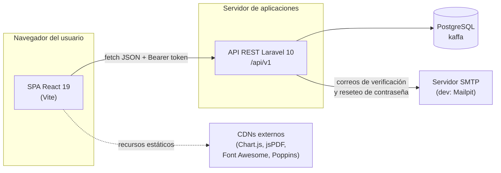
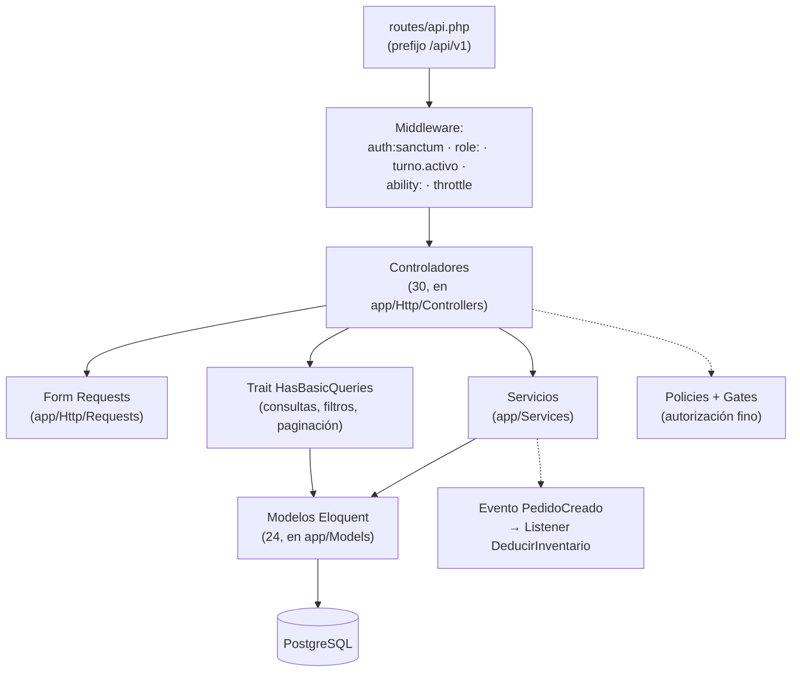
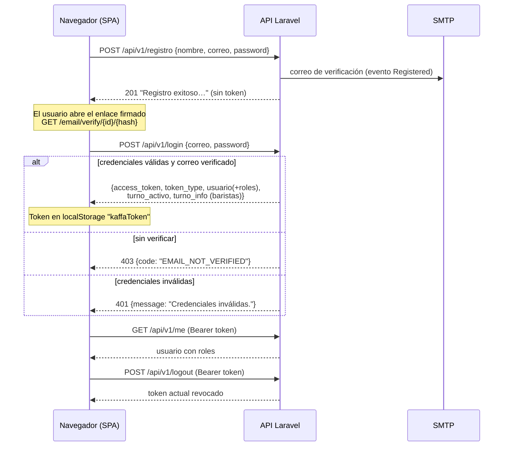
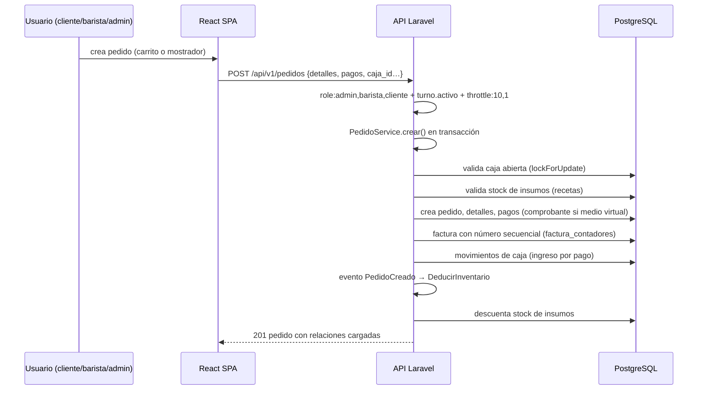

# 01 — Arquitectura del Sistema

## 1. Descripción general

KAFFA es un sistema POS (punto de venta) para cafetería con arquitectura **desacoplada**:

- **Frontend**: SPA React 19 construida con Vite, servida por separado (desarrollo: Vite dev server en `:5173`; producción: servidor web en `:80`).
- **Backend**: API REST Laravel 10 exclusivamente JSON (no renderiza vistas de aplicación), con prefijo `/api/v1`.
- **Base de datos**: PostgreSQL (verificado en `backend-kaffa/.env`: `DB_CONNECTION=pgsql`; también `phpunit.xml` apunta a `pgsql`).
- **Autenticación**: tokens personales Sanctum enviados como `Authorization: Bearer {token}`.

No hay comunicación por websockets: la SPA actualiza datos por **sondeo (polling)** en intervalos de 5 a 60 segundos.

## 2. Diagrama de contexto



**Figura 1.** _Diagrama de contexto del sistema_

Fuente: `REACT_clean/REACT_kaffa/src/lib/api.js` (base `/api/v1`, `fetch` nativo), `vite.config.js` (proxy `/api` → `http://localhost:8000`), `backend-kaffa/routes/api.php`, `app/Providers/RouteServiceProvider.php` (prefijo `api/v1`), `.env`.

## 3. Stack tecnológico (verificado)

### 3.1 Backend (`backend-kaffa/composer.json` + `composer.lock`)

**Tabla 1.** _Stack del backend (composer.json / composer.lock)_

| Tecnología / Paquete | Versión verificada |
|----------------------|---------------------|
| PHP | requisito `^8.1` |
| Laravel Framework | `10.50.2` (restricción `^10.10`) [3] |
| Laravel Sanctum | `3.3.3` (`^3.3`) [4] |
| GuzzleHTTP | `7.10.0` (`^7.2`) |
| Laravel Tinker | `2.11.1` |
| PHPUnit (dev) | `^10.1` |
| Laravel Ignition (dev) | `2.9.1` |
| PostgreSQL | motor externo; conexión en `.env` (`DB_PORT=5432`) [5] |

### 3.2 Frontend (`REACT_clean/REACT_kaffa/package.json` + lockfiles)

**Tabla 2.** _Dependencias del frontend (package.json / pnpm-lock.yaml)_

| Paquete | Versión |
|---------|---------|
| React / ReactDOM | `19.2.8` [6] |
| React Router DOM | `7.18.2` |
| React Hook Form | `7.86.0` (pnpm) |
| Sonner (notificaciones) | `2.0.8` |
| Vite | `8.2.2` (pnpm) [7] |
| ESLint | `^10.8.0` |

> Gestor de paquetes: **pnpm** (`pnpm-lock.yaml` es la fuente única de versiones; `package-lock.json` fue eliminado en la pasada de seguridad de 2026-09 para evitar resoluciones divergentes).

### 3.3 Convenciones relevantes

- Zona horaria de la aplicación: `America/Bogota` (`config/app.php`).
- Estilos: la SPA carga hojas CSS estáticas desde `public/css/` en tiempo de ejecución mediante `src/lib/stylesManager.js` (no bundling de CSS por página); variables de tema en `src/styles/variables.css` (paleta SENA, tema claro/oscuro).
- Librerías cargadas por CDN en tiempo de ejecución: Chart.js (gráficas del admin), jsPDF 2.5.1 (impresión de recibos del barista), Font Awesome 6 y Google Fonts Poppins (`index.html`).

## 4. Arquitectura del backend

Organización por capas (todo en `backend-kaffa/app/`):



**Figura 2.** _Capas del backend Laravel_

- **`routes/api.php`**: define todos los endpoints y el esquema RBAC (comentario de cabecera del propio archivo).
- **Middleware propio** (`app/Http/Middleware/`, alias en `app/Http/Kernel.php`): `role:` (`CheckRole`), `turno.activo` (`EnsureActiveTurno`) y `ability:` (`EnsureTokenCanAbility`: exige que el token Sanctum posea el alcance del recurso en las rutas de escritura; responde 403 `TOKEN_SIN_ABILITY`).
- **Controladores**: 30 controladores planos (sin subcarpetas), CRUD fino delegado en el trait `App\Models\Concerns\HasBasicQueries` (`consultar()`, `buscarPorId()`, `crearRegistro()`, `actualizarRegistro()`, `eliminarRegistro()`), que centraliza filtros, ordenamiento y paginación (por defecto 15 por página, máximo 100).
- **Servicios** (`app/Services/`): `PedidoService`, `CompraService`, `GastoService`, `MermaService`, `TurnoService`, `FacturaService`, `TransactionService` (transacciones con reintentos por deadlocks, códigos PostgreSQL `40P01`).
- **Eventos**: `PedidoCreado` → listener `DeducirInventario` (descuenta stock de insumos por receta, de forma atómica); `Registered` → envío de correo de verificación (`EventServiceProvider`).
- **Autorización fino**: 17 policies + `BasePolicy` y gates `view-record` / `create-record` / `manage-record` (`app/Providers/AuthServiceProvider.php`).
- **Recursos**: `app/Http/Resources/BaseResource.php` elimina `password`/`remember_token` de toda respuesta; envoltura estándar de paginación de Laravel `{data, links, meta}`.

## 5. Arquitectura del frontend

Organización de `src/`:

**Tabla 3.** _Estructura de carpetas del frontend_

| Carpeta | Contenido |
|---------|-----------|
| `pages/` | Páginas públicas (Home, Menu, Eventos, SobreNosotros, Contacto), auth (Login, Registro, Forgot/ResetPassword, VerifyEmailNotice), cliente (MisPedidos, ChatBarista) y dashboards (`dashboard-admin/` con 16 vistas, `dashboard-barista/` con 4 vistas). |
| `components/` | `ErrorBoundary`, `RequireRole` (guard de rutas), `layout/` (Navbar + Footer), `product/ProductCard`, `cliente/ClienteWidgets` (4 modales de cliente). |
| `lib/` | `api.js` (cliente HTTP con `fetch`, adjunta `Bearer`, maneja 401 limpiando sesión), `auth.js` (login/registro/logout/refresh/requisitos de rol), `storage.js`, `toast.js`, `utils.js`, `stylesManager.js`, `productos-store.js`. |
| `hooks/` | `useCatalogo`, `useEquipo`, `useChatNoLeidos`, `useStyles`, `useBodyClass`, `useDashboardTheme`. |
| `context/` | `CarritoContext` (carrito, pago y perfil del cliente). |
| `data/` | Catálogo demo estático (`productos.js`, 10 productos) usado cuando la API no responde. |

Características:

- **Enrutamiento** (`src/App.jsx`): rutas públicas bajo `Layout`; `/pedidos` y `/chat` protegidas con `RequireRole role="cliente"`; `/admin-dashboard` con `RequireRole role="admin"`; `/barista-dashboard/{pedidos,inventario,chat,caja}` con `RequireRole role="barista"`.
- El **panel admin** cambia de sección por estado interno (`DashboardAdmin.jsx`, mapa `NAV`/`VIEWS`), no por URL.
- **Sin librería de estado global**: estado por Context (carrito) + `localStorage` (`kaffaToken`, `kaffaUser`, `kaffaCarrito`, `kaffaTheme`).
- **Sondeo**: pedidos 10 s, chat 5 s, insumos 15 s, cajas 30 s (el backend limita `/cajas` a 10 escrituras/min), turno 60 s.

## 6. Flujo de autenticación



**Figura 3.** _Flujo de autenticación (registro → verificación → login → logout)_

Fuente: `AuthController::login/register`, registro de rutas públicas en `routes/api.php`.

## 7. Flujo de pedido (POS) y descuento de inventario



**Figura 4.** _Flujo de pedido POS con descuento de inventario_

Fuente: `app/Services/PedidoService.php`, `app/Listeners/DeducirInventario.php`, ruta `pedidos.store` en `routes/api.php`.

## 8. Topología de despliegue

### 8.1 Desarrollo

```text
React SPA (Vite :5173) ──proxy /api──▶ Laravel (php artisan serve :8000) ──▶ PostgreSQL :5432
SMTP local (Mailpit :1025) ◀── correos de verificación/reseteo
```

- Proxy definido en `REACT_clean/REACT_kaffa/vite.config.js`.
- La SPA llama siempre a la ruta relativa `/api/v1` (`src/lib/api.js`).

### 8.2 Producción (topología prevista por el código)

- Un servidor web (p. ej. Apache en `:80`) sirve la SPA compilada (`vite build` → `dist/`) **y** hace proxy/pasarela de `/api/v1` al backend Laravel. Comentario fuente: `vite.config.js` («Para Apache en :80 quita el proxy»).
- Variables previstas: `FRONTEND_URL` (enlaces de correo), `CORS_ALLOWED_ORIGINS` (origen permitido), `SANCTUM_EXPIRATION` (expiración de tokens), SMTP real.
- `[NO VERIFICADO]` No existe en el repositorio evidencia de un despliegue en producción activo (sin Dockerfile, CI/CD ni configuración de servidor). Ver `07-despliegue.md`.
