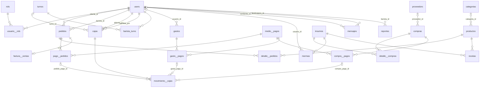

# 02 — Base de Datos

## 1. Motor y convenciones

- **Motor**: PostgreSQL (`.env`: `DB_CONNECTION=pgsql`, `DB_HOST=127.0.0.1`, `DB_PORT=5432`, `DB_DATABASE=kaffa`). Los tests usan la base `kaffa_test` (`phpunit.xml`).
- **Zona horaria de la aplicación**: `America/Bogota` (`config/app.php`).
- **Nomenclatura**: tablas en español; las tabletas de detalle de pagos y pivotes usan doble guion bajo (`pago__pedidos`, `usuario__rols`, `movimiento__cajas`), siguiendo el estilo del generador de código original.
- **Borrado lógico (soft delete)**: columnas `deleted_at` en la mayoría de tablas de negocio (verificado por migraciones y rasgo `SoftDeletes` en los modelos). Excepciones: `pago__pedidos`, `detalle__pedidos`, `detalle__compras`, `compra__pagos`, `gasto__pagos`, `movimiento__cajas`, `recetas`, `usuario__rols`, `barista_turno`, `turnos`, `rols`, `medio__pagos`, `factura__ventas`, `factura_contadores`, `mensajes`.
- **Dinero**: `decimal(10,2)` en todas las columnas monetarias; casts `decimal:2` en los modelos Eloquent.
- **Migraciones**: 37 archivos en `backend-kaffa/database/migrations/` (24 de creación de tablas + 13 de alteración/índices).

> `.env.example` ya declara la conexión correcta (`pgsql`/5432/`kaffa`), corregida en la pasada de seguridad de 2026-09.

## 2. Inventario de tablas (29)

### 2.1 Infraestructura de Laravel (4)

**Tabla 1.** _Inventario: tablas de infraestructura de Laravel_

| Tabla | Propósito |
|-------|-----------|
| `users` | Usuarios del sistema (con columnas personalizadas `nombre`, `correo`, `activo`, `foto`, `email_verified_at`). |
| `password_reset_tokens` | Tokens de recuperación de contraseña (columna `email` por convención de Laravel). |
| `failed_jobs` | Cola de trabajos fallidos (sin uso activo: `QUEUE_CONNECTION=sync`). |
| `personal_access_tokens` | Tokens Sanctum (`tokenable` polimórfico, `token` único, `abilities`, `expires_at`). |

### 2.2 Núcleo de negocio (21)

**Tabla 2.** _Inventario: tablas del núcleo de negocio_

| Tabla | Propósito |
|-------|-----------|
| `rols` | Roles del sistema: `admin`, `barista`, `cliente` (sembrados). |
| `usuario__rols` | Pivote N:M usuario ↔ rol (un usuario puede tener varios roles). |
| `categorias` | Categorías de productos del menú. |
| `productos` | Productos del menú con `precio_venta` e `imagen` (URL). |
| `recetas` | Pivote N:M producto ↔ insumo con `cantidad` (cuánto insumo consume cada producto). |
| `insumos` | Inventario: insumos con `stock_actual`, `stock_minimo`, `unidad_medida`. |
| `proveedors` | Proveedores de insumos (NIT único). |
| `medio__pagos` | Medios de pago; `es_virtual` distingue los que exigen comprobante. |
| `pedidos` | Pedidos (venta) con estado y propina. |
| `detalle__pedidos` | Líneas de pedido (producto, cantidad, precio, `nota`). |
| `pago__pedidos` | Pagos de pedidos (con `comprobante_url` si el medio es virtual). |
| `factura__ventas` | Factura 1:1 por pedido, número secuencial único. |
| `factura_contadores` | Contador transaccional de numeración de facturas por año. |
| `compras` | Compras a proveedores con `numero_factura_proveedor`. |
| `detalle__compras` | Líneas de compra (insumo, cantidad, `precio_costo`). |
| `compra__pagos` | Pagos de compras (con `comprobante_url`). |
| `gastos` | Gastos operativos (el monto vive en sus pagos). |
| `gasto__pagos` | Pagos de gastos (con `comprobante_url`). |
| `mermas` | Mermas de insumos (cantidad, motivo). |
| `cajas` | Sesiones de caja con arqueo (apertura/cierre, sistema vs físico, efectivo vs digital). |
| `movimiento__cajas` | Movimientos de caja (`ingreso`/`egreso`) enlazados a pagos. |

### 2.3 Módulos de características (4)

**Tabla 3.** _Inventario: tablas de los módulos de características_

| Tabla | Propósito |
|-------|-----------|
| `turnos` | Turnos de trabajo: `fecha` + `tipo` (`mañana`/`tarde`), únicos por combinación. |
| `barista_turno` | Pivote N:M barista ↔ turno (quiénes trabajan cada turno). |
| `reportes` | Reportes de novedades creados por baristas (prioridad, leído). |
| `mensajes` | Chat cliente ↔ barista/admin (leído). |

## 3. Diagrama entidad–relación

**Figura 1.** _Diagrama entidad–relación del esquema KAFFA_

## 4. Diccionario de datos

Fuente de cada tabla: los archivos de migración indicados. `PK` = clave primaria; `FK` = clave foránea; `NULL` = admite nulos; los tipos están según `$table->…` de Laravel.

### 4.1 `users` — `2014_10_12_000000_create_users_table.php` + alters

**Tabla 4.** _Diccionario de la tabla `users`_

| Campo | Tipo | NULL | Clave | Detalle |
|-------|------|------|-------|---------|
| id | bigint | No | PK | autoincrement |
| nombre | varchar(100) | No | | |
| correo | varchar(120) | No | UNIQUE | login y correos (el modelo sobrescribe `getEmailForPasswordReset` para usar `correo`) |
| password | varchar(255) | No | | hash bcrypt (migración de índices la convierte de TEXT a VARCHAR(255)) |
| activo | boolean | No | | default `true` |
| foto | varchar(500) | Sí | | URL (patrón Cloudinary); añadida en `2026_09_16_000000_add_foto_to_users_table.php` |
| email_verified_at | timestamp | Sí | | verificación de correo; añadida con backfill `now()` para usuarios existentes (`2026_09_09_141436…php`) |
| remember_token | varchar(100) | Sí | | |
| deleted_at | timestamp | Sí | | soft delete |
| created_at / updated_at | timestamp | No | | |

### 4.2 `rols` — `2026_04_07_000002_create_rols_table.php`

**Tabla 5.** _Diccionario de la tabla `rols`_

| Campo | Tipo | NULL | Clave | Detalle |
|-------|------|------|-------|---------|
| id | bigint | No | PK | |
| nombre | varchar(50) | No | UNIQUE | valores sembrados: `admin`, `barista`, `cliente` |
| created_at / updated_at | timestamp | No | | |

### 4.3 `usuario__rols` — `2026_04_07_000007_create_usuario__rols_table.php`

**Tabla 6.** _Diccionario de la tabla `usuario__rols`_

| Campo | Tipo | NULL | Clave | Detalle |
|-------|------|------|-------|---------|
| usuario_id | bigint | No | FK → users.id, PK compuesta | onDelete cascade |
| rol_id | bigint | No | FK → rols.id, PK compuesta | onDelete cascade |
| created_at / updated_at | timestamp | No | | |

> Un usuario puede tener varios roles simultáneos (p. ej. barista + cliente).

### 4.4 `categorias` — `2026_04_07_000003_create_categorias_table.php`

**Tabla 7.** _Diccionario de la tabla `categorias`_

| Campo | Tipo | NULL | Clave | Detalle |
|-------|------|------|-------|---------|
| id | bigint | No | PK | |
| nombre | varchar(100) | No | | sembradas: Cafés, Postres, Snacks |
| deleted_at | timestamp | Sí | | |
| created_at / updated_at | timestamp | No | | |

### 4.5 `productos` — `2026_04_07_000008_create_productos_table.php` + `2026_08_26_000001_add_imagen_to_productos.php`

**Tabla 8.** _Diccionario de la tabla `productos`_

| Campo | Tipo | NULL | Clave | Detalle |
|-------|------|------|-------|---------|
| id | bigint | No | PK | |
| nombre | varchar(150) | No | | |
| descripcion | text | Sí | | |
| imagen | varchar(500) | Sí | | URL de imagen (añadida 2026-08-26) |
| precio_venta | decimal(10,2) | No | | COP |
| categoria_id | bigint | Sí | FK → categorias.id | |
| activo | boolean | No | | default `true` |
| deleted_at | timestamp | Sí | | |
| created_at / updated_at | timestamp | No | | |

### 4.6 `recetas` — `2026_04_07_000009_create_recetas_table.php`

**Tabla 9.** _Diccionario de la tabla `recetas`_

| Campo | Tipo | NULL | Clave | Detalle |
|-------|------|------|-------|---------|
| producto_id | bigint | No | FK → productos.id, PK compuesta | cascade |
| insumo_id | bigint | No | FK → insumos.id, PK compuesta | cascade |
| cantidad | decimal(10,2) | No | | consumo del insumo por producto |
| created_at / updated_at | timestamp | No | | |

### 4.7 `insumos` — `2026_04_07_000005_create_insumos_table.php`

**Tabla 10.** _Diccionario de la tabla `insumos`_

| Campo | Tipo | NULL | Clave | Detalle |
|-------|------|------|-------|---------|
| id | bigint | No | PK | |
| nombre | varchar(100) | No | | validado único en `StoreInsumoRequest` |
| unidad_medida | varchar(20) | Sí | | p. ej. kg, lt, und |
| stock_actual | decimal(10,2) | No | | default 0 |
| stock_minimo | decimal(10,2) | No | | default 0 |
| activo | boolean | No | | default `true` |
| deleted_at | timestamp | Sí | | |
| created_at / updated_at | timestamp | No | | |

> El stock se **incrementa** con compras, se **reduce** con ventas (listener `DeducirInventario`) y mermas, y se **restaura** al eliminar mermas o compras (`CompraService`, `MermaService`).

### 4.8 `proveedors` — `2026_04_07_000006_create_proveedors_table.php`

**Tabla 11.** _Diccionario de la tabla `proveedors`_

| Campo | Tipo | NULL | Clave | Detalle |
|-------|------|------|-------|---------|
| id | bigint | No | PK | |
| nit | varchar(50) | No | UNIQUE | |
| nombre | varchar(150) | No | | |
| telefono | varchar(50) | Sí | | |
| correo | varchar(120) | Sí | | |
| direccion | text | Sí | | |
| activo | boolean | No | | default `true` |
| deleted_at | timestamp | Sí | | |
| created_at / updated_at | timestamp | No | | |

### 4.9 `medio__pagos` — `2026_04_07_000004…` + `2026_06_09_020704_add_es_virtual…`

**Tabla 12.** _Diccionario de la tabla `medio__pagos`_

| Campo | Tipo | NULL | Clave | Detalle |
|-------|------|------|-------|---------|
| id | bigint | No | PK | |
| nombre | varchar(50) | No | UNIQUE | sembrados: Efectivo, Tarjeta de Crédito, Tarjeta de Débito, Transferencia Bancaria, Pago Móvil, QR (Pago Digital) |
| es_virtual | boolean | No | | default `false`; `true` ⇒ el pago exige `comprobante_url` |
| created_at / updated_at | timestamp | No | | |

> Los IDs de medios virtuales se cachean 5 minutos (`Medio_Pago::virtualIds()`, clave `medios_pago:virtual_ids`) y la caché se invalida al guardar/eliminar un medio.

### 4.10 `pedidos` — `2026_04_07_000011_create_pedidos_table.php`

**Tabla 13.** _Diccionario de la tabla `pedidos`_

| Campo | Tipo | NULL | Clave | Detalle |
|-------|------|------|-------|---------|
| id | bigint | No | PK | |
| cliente_id | bigint | Sí | FK → users.id | |
| barista_id | bigint | Sí | FK → users.id | |
| total | decimal(10,2) | Sí | | consistencia validada en `PedidoService` |
| propina | decimal(10,2) | No | | default 0 |
| estado | varchar(20) | No | | default `pendiente`; valores validados: `pendiente`, `pagado`, `cancelado`, `entregado` |
| deleted_at | timestamp | Sí | | |
| created_at / updated_at | timestamp | No | | |

### 4.11 `detalle__pedidos` — `2026_04_07_000016…` + `2026_09_04_173307_add_nota…`

**Tabla 14.** _Diccionario de la tabla `detalle__pedidos`_

| Campo | Tipo | NULL | Clave | Detalle |
|-------|------|------|-------|---------|
| id | bigint | No | PK | |
| pedido_id | bigint | No | FK → pedidos.id | cascade |
| producto_id | bigint | No | FK → productos.id | |
| cantidad | decimal(10,2) | No | | validada entera ≥ 1 en `StorePedidoRequest` |
| precio_unitario | decimal(10,2) | Sí | | |
| subtotal | decimal(10,2) | Sí | | |
| nota | varchar(500) | Sí | | nota por línea (añadida 2026-09-04) |
| created_at / updated_at | timestamp | No | | |

> Sin soft delete: `PedidoService::eliminar` borra físicamente los detalles al eliminar un pedido.

### 4.12 `pago__pedidos` — `2026_04_07_000015…` + `2026_06_09_020705_add_comprobante_url…`

**Tabla 15.** _Diccionario de la tabla `pago__pedidos`_

| Campo | Tipo | NULL | Clave | Detalle |
|-------|------|------|-------|---------|
| id | bigint | No | PK | |
| pedido_id | bigint | No | FK → pedidos.id | cascade |
| medio_pago_id | bigint | No | FK → medio__pagos.id | |
| monto | decimal(10,2) | No | | mínimo 0.01 |
| comprobante_url | varchar(500) | Sí | | obligatoria si el medio es virtual (validación `withValidator`) |
| created_at / updated_at | timestamp | No | | |

### 4.13 `factura__ventas` — `2026_04_07_000014_create_factura__ventas_table.php`

**Tabla 16.** _Diccionario de la tabla `factura__ventas`_

| Campo | Tipo | NULL | Clave | Detalle |
|-------|------|------|-------|---------|
| id | bigint | No | PK | |
| pedido_id | bigint | No | FK → pedidos.id, UNIQUE | 1 pedido = 1 factura |
| numero_factura | varchar(50) | No | UNIQUE | generado por el servidor: `F{año}{contador 6 dígitos}` |
| subtotal | decimal(10,2) | No | | |
| impuestos | decimal(10,2) | No | | default 0 |
| total | decimal(10,2) | No | | |
| fecha_emision | timestamp | No | | default now |
| created_at / updated_at | timestamp | No | | |

> El cliente **no envía** `numero_factura` (comentario en `StoreFacturaVentaRequest`); lo genera `FacturaService::generarNumeroFactura()` dentro de una transacción con `lockForUpdate` sobre `factura_contadores`.

### 4.14 `factura_contadores` — `2026_08_03_000000_create_factura_contadores_table.php`

**Tabla 17.** _Diccionario de la tabla `factura_contadores`_

| Campo | Tipo | NULL | Clave | Detalle |
|-------|------|------|-------|---------|
| id | bigint | No | PK | |
| nombre | varchar(20) | No | UNIQUE(nombre, anio) | prefijo del contador (p. ej. `F`) |
| anio | smallint unsigned | No | UNIQUE(nombre, anio) | |
| valor | int unsigned | No | | default 0; se incrementa con bloqueo pesimista |
| created_at / updated_at | timestamp | No | | |

### 4.15 `compras` — `2026_04_07_000013_create_compras_table.php`

**Tabla 18.** _Diccionario de la tabla `compras`_

| Campo | Tipo | NULL | Clave | Detalle |
|-------|------|------|-------|---------|
| id | bigint | No | PK | |
| proveedor_id | bigint | Sí | FK → proveedors.id | |
| numero_factura_proveedor | varchar(100) | No | | indexada (no única a nivel BD) |
| fecha_compra | timestamp | No | | default now |
| total_compra | decimal(10,2) | No | | |
| deleted_at | timestamp | Sí | | |
| created_at / updated_at | timestamp | No | | |

### 4.16 `detalle__compras` — `2026_04_07_000017…`

**Tabla 19.** _Diccionario de la tabla `detalle__compras`_

| Campo | Tipo | NULL | Clave | Detalle |
|-------|------|------|-------|---------|
| id | bigint | No | PK | |
| compra_id | bigint | No | FK → compras.id | cascade |
| insumo_id | bigint | No | FK → insumos.id | |
| cantidad | decimal(10,2) | No | | |
| precio_costo | decimal(10,2) | No | | |
| created_at / updated_at | timestamp | No | | |

### 4.17 `compra__pagos` — `2026_04_07_000018…` + comprobante_url

**Tabla 20.** _Diccionario de la tabla `compra__pagos`_

| Campo | Tipo | NULL | Clave | Detalle |
|-------|------|------|-------|---------|
| id | bigint | No | PK | |
| compra_id | bigint | No | FK → compras.id | cascade |
| medio_pago_id | bigint | No | FK → medio__pagos.id | |
| monto | decimal(10,2) | No | | |
| fecha_pago | timestamp | No | | default now |
| comprobante_url | varchar(500) | Sí | | obligatoria si el medio es virtual |
| created_at / updated_at | timestamp | No | | |

### 4.18 `gastos` — `2026_04_07_000012…`

**Tabla 21.** _Diccionario de la tabla `gastos`_

| Campo | Tipo | NULL | Clave | Detalle |
|-------|------|------|-------|---------|
| id | bigint | No | PK | |
| descripcion | text | No | | |
| categoria | varchar(100) | Sí | | indexada |
| usuario_id | bigint | Sí | FK → users.id | forzado al usuario autenticado en `GastoService` |
| deleted_at | timestamp | Sí | | |
| created_at / updated_at | timestamp | No | | |

> El monto de un gasto no está en esta tabla: se registra en sus filas de `gasto__pagos`.

### 4.19 `gasto__pagos` — `2026_04_07_000019…` + comprobante_url

**Tabla 22.** _Diccionario de la tabla `gasto__pagos`_

| Campo | Tipo | NULL | Clave | Detalle |
|-------|------|------|-------|---------|
| id | bigint | No | PK | |
| gasto_id | bigint | No | FK → gastos.id | cascade |
| medio_pago_id | bigint | No | FK → medio__pagos.id | |
| monto | decimal(10,2) | No | | |
| fecha_pago | timestamp | No | | default now |
| comprobante_url | varchar(500) | Sí | | obligatoria si el medio es virtual |
| created_at / updated_at | timestamp | No | | |

### 4.20 `mermas` — `2026_04_07_000020…`

**Tabla 23.** _Diccionario de la tabla `mermas`_

| Campo | Tipo | NULL | Clave | Detalle |
|-------|------|------|-------|---------|
| id | bigint | No | PK | |
| insumo_id | bigint | No | FK → insumos.id | |
| cantidad | decimal(10,2) | No | | validada contra stock en `MermaService` |
| motivo | text | Sí | | |
| usuario_id | bigint | Sí | FK → users.id | forzado en `MermaService` |
| deleted_at | timestamp | Sí | | |
| created_at / updated_at | timestamp | No | | |

### 4.21 `cajas` — `2026_04_07_000010…` + `2026_08_26_000004_add_detalle_caja…`

**Tabla 24.** _Diccionario de la tabla `cajas`_

| Campo | Tipo | NULL | Clave | Detalle |
|-------|------|------|-------|---------|
| id | bigint | No | PK | |
| abierta_por | bigint | No | FK → users.id | forzado al autenticado al abrir |
| cerrada_por | bigint | Sí | FK → users.id | forzado al autenticado al cerrar |
| turno_id | bigint | Sí | FK → turnos.id | asignado automáticamente al abrir (turno activo del barista; null para admin) |
| estado | varchar(20) | No | | default `abierta`; indexada |
| monto_apertura_sistema | decimal(10,2) | No | | default 0 |
| monto_apertura_fisico | decimal(10,2) | No | | requerido al abrir |
| monto_apertura_efectivo | decimal(10,2) | No | | default 0; desglose de apertura |
| monto_apertura_digital | decimal(10,2) | No | | default 0; desglose de apertura |
| monto_cierre_sistema | decimal(10,2) | Sí | | **calculado por el servidor** al cerrar: apertura + ingresos − egresos |
| monto_cierre_fisico | decimal(10,2) | Sí | | lo declara quien cierra |
| monto_cierre_efectivo | decimal(10,2) | Sí | | desglose de cierre |
| monto_cierre_digital | decimal(10,2) | Sí | | desglose de cierre |
| fecha_apertura | timestamp | No | | default now |
| fecha_cierre | timestamp | Sí | | |
| deleted_at | timestamp | Sí | | |
| created_at / updated_at | timestamp | No | | |

> Regla de negocio: no se puede eliminar una caja con movimientos (`Caja::eliminarRegistro` lanza `BusinessRuleException`).

### 4.22 `movimiento__cajas` — `2026_04_07_000021…`

**Tabla 25.** _Diccionario de la tabla `movimiento__cajas`_

| Campo | Tipo | NULL | Clave | Detalle |
|-------|------|------|-------|---------|
| id | bigint | No | PK | |
| caja_id | bigint | No | FK → cajas.id | |
| tipo | varchar(20) | No | | `ingreso` o `egreso`; indexada |
| monto | decimal(10,2) | No | | |
| pedido_pago_id | bigint | Sí | FK → pago__pedidos.id | |
| compra_pago_id | bigint | Sí | FK → compra__pagos.id | |
| gasto_pago_id | bigint | Sí | FK → gasto__pagos.id | |
| descripcion | text | Sí | | |
| created_at / updated_at | timestamp | No | | |

> Los movimientos no se crean directamente por la API: los emiten los servicios al registrar pagos (`MovimientoCajaPolicy` lo documenta).

### 4.23 `turnos` — `2026_06_14_152013…`

**Tabla 26.** _Diccionario de la tabla `turnos`_

| Campo | Tipo | NULL | Clave | Detalle |
|-------|------|------|-------|---------|
| id | bigint | No | PK | |
| fecha | date | No | UNIQUE(fecha, tipo) | |
| tipo | varchar — enum `mañana`/`tarde` | No | UNIQUE(fecha, tipo) | horarios: mañana 07:00–13:00, tarde 13:00–18:00 (`TurnoService`) |
| created_at / updated_at | timestamp | No | | |

### 4.24 `barista_turno` — `2026_06_14_152014…`

**Tabla 27.** _Diccionario de la tabla `barista_turno`_

| Campo | Tipo | NULL | Clave | Detalle |
|-------|------|------|-------|---------|
| barista_id | bigint | No | FK → users.id, PK compuesta | cascade |
| turno_id | bigint | No | FK → turnos.id, PK compuesta | cascade |
| created_at / updated_at | timestamp | No | | |

### 4.25 `reportes` — `2026_08_26_000002…`

**Tabla 28.** _Diccionario de la tabla `reportes`_

| Campo | Tipo | NULL | Clave | Detalle |
|-------|------|------|-------|---------|
| id | bigint | No | PK | |
| barista_id | bigint | Sí | FK → users.id | forzado al barista autenticado al crear |
| mensaje | text | No | | novedad reportada |
| prioridad | varchar(20) | No | | default `media`; valores: `baja`, `media`, `alta` |
| leido | boolean | No | | default `false` |
| deleted_at | timestamp | Sí | | |
| created_at / updated_at | timestamp | No | | |

### 4.26 `mensajes` — `2026_08_26_000003…`

**Tabla 29.** _Diccionario de la tabla `mensajes`_

| Campo | Tipo | NULL | Clave | Detalle |
|-------|------|------|-------|---------|
| id | bigint | No | PK | |
| remitente_id | bigint | No | FK → users.id | cascade |
| destinatario_id | bigint | No | FK → users.id | cascade |
| mensaje | text | No | | máx. 1000 (validación) |
| leido | boolean | No | | default `false` |
| created_at / updated_at | timestamp | No | | |

> Reglas: no auto-mensajes, no chat cliente↔cliente, destinatario inactivo rechazado (422) — `MensajeController::store`.

### 4.27 `personal_access_tokens` — `2019_12_14_000001…`

**Tabla 30.** _Diccionario de la tabla `personal_access_tokens`_

| Campo | Tipo | NULL | Clave | Detalle |
|-------|------|------|-------|---------|
| id | bigint | No | PK | |
| tokenable_type / tokenable_id | string / bigint | No | índice | morfismo (User) |
| name | varchar | No | | `auth_token` |
| token | varchar(64) | No | UNIQUE | hash del token |
| abilities | text | Sí | | p. ej. `["*"]` (admin); se almacenan pero no se validan (ver `05-seguridad.md`) |
| last_used_at | timestamp | Sí | | |
| expires_at | timestamp | Sí | | se fija si `SANCTUM_EXPIRATION` está definida |
| created_at / updated_at | timestamp | No | | |

### 4.28 `password_reset_tokens` — `2014_10_12_100000…`

**Tabla 31.** _Diccionario de la tabla `password_reset_tokens`_

| Campo | Tipo | NULL | Clave | Detalle |
|-------|------|------|-------|---------|
| email | string | No | PK | es el `correo` del usuario |
| token | string | No | | |
| created_at | timestamp | Sí | | |

### 4.29 `failed_jobs` — `2019_08_19_000000…`

**Tabla 32.** _Diccionario de la tabla `failed_jobs`_

Estructura estándar de Laravel (id, uuid único, connection, queue, payload, exception, failed_at). Sin uso activo con `QUEUE_CONNECTION=sync`.

## 5. Índices de rendimiento — `2026_07_31_000000_add_performance_indexes_to_tables.php`

**Tabla 33.** _Índices de rendimiento añadidos por tabla_

| Tabla | Índices adicionados |
|-------|---------------------|
| pedidos | `estado`, `created_at` |
| pago__pedidos | `created_at` |
| compras | `created_at`, `numero_factura_proveedor` |
| gastos | `created_at`, `categoria` |
| mermas | `created_at` |
| movimiento__cajas | `created_at`, `tipo` |
| factura__ventas | `created_at` |
| cajas | `estado` |
| users | conversión de `password` TEXT → VARCHAR(255) (SQL específico para MySQL y pgsql) |

Además, índices únicos declarados en las migraciones: `factura__ventas.pedido_id` y `numero_factura`, `proveedors.nit`, `productos/medio__pagos` según tabla, `factura_contadores(nombre, anio)`, `turnos(fecha, tipo)`.

## 6. Seeders — `backend-kaffa/database/seeders/`

**Tabla 34.** _Seeders del proyecto (orden de ejecución)_

Orden de ejecución (`DatabaseSeeder`): `RolSeeder` → `MedioPagoSeeder` → `UserSeeder` → `TurnoSeeder` → `CatalogSeeder`.

| Seeder | Datos |
|--------|-------|
| `RolSeeder` | Roles `admin`, `barista`, `cliente` (`firstOrCreate`). |
| `MedioPagoSeeder` | 6 medios: Efectivo, Tarjeta de Crédito, Tarjeta de Débito (no virtuales); Transferencia Bancaria, Pago Móvil, QR (Pago Digital) (virtuales). |
| `UserSeeder` | `admin@kaffa.com`/`admin123`, `barista@kaffa.com`/`barista123`, `cliente@kaffa.com`/`cliente123`; todos verificados y con foto demo (URL Cloudinary). |
| `TurnoSeeder` | Para el día actual (America/Bogota) crea turnos mañana y tarde y asigna a **todos** los baristas. |
| `CatalogSeeder` | 3 categorías (Cafés, Postres, Snacks), 20 insumos con stocks, 10 productos con precios en COP e `imagen` (URL externa) y recetas producto↔insumo (p. ej. Capuchino = 0.02 kg café + 0.25 lt leche). |

> El `UserFactory` (`database/factories/UserFactory.php`) está alineado con el esquema real (`nombre`/`correo`, `activo`, estados `unverified()`/`inactive()`). No lo usan los tests actuales (que crean usuarios manualmente), pero queda operativo para `User::factory()`.
