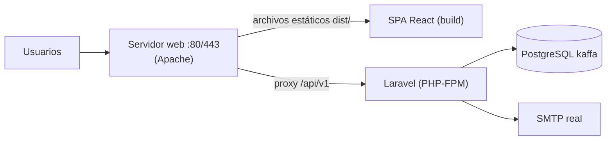

# 07 — Despliegue y Configuración

> `[NO VERIFICADO]` No hay en el repositorio evidencia de un despliegue de producción activo (sin Dockerfile, docker-compose, CI/CD ni configuración de servidor). Este documento describe la **topología prevista por el propio código** (comentarios de configuración y `vite.config.js`) y las variables necesarias.

## 1. Entorno de desarrollo (verificado)

```text
:5173  Vite dev server (React SPA)          → sirve la SPA con HMR
:8000  php artisan serve (Laravel)          → API /api/v1
:5432  PostgreSQL (kaffa)
:1025  Mailpit SMTP de desarrollo (opcional)
```

- La SPA usa la base relativa `/api/v1`; Vite la proxiexa a `:8000` (`vite.config.js`).

## 2. Entorno de producción (previsto por el código)

Topología implícita en `vite.config.js` («Para Apache en :80 quita el proxy») y en la configuración de Laravel:



**Figura 1.** _Topología de producción prevista (servidor web + PHP-FPM + PostgreSQL)_

Pasos generales (aplicación PHP estándar Laravel + SPA estática):

1. **Frontend**: `npm run build` y publicar `dist/` en el servidor web.
2. **Backend**: desplegar `backend-kaffa/` (sin `vendor/`, regenerarlo con `composer install --no-dev --optimize-autoloader`), apuntar el DocumentRoot/web-entry de Laravel a `public/` y en proxy/rutas, publicar `/api/v1` desde el mismo dominio de la SPA (la SPA llama la ruta relativa).
3. **Base de datos**: PostgreSQL dedicado; `php artisan migrate --seed` solo la primera vez (los seeders son idempotentes con `firstOrCreate`).
4. **Enlaces de correo**: `FRONTEND_URL` debe apuntar al dominio público de la SPA (los correos de verificación y reseteo enlazan a `{FRONTEND_URL}/…`).
5. **Cron/queue** (opcional): con `QUEUE_CONNECTION=sync` no se necesita worker; si se cambia a `redis`/`database`, programar `php artisan schedule:run`/queue:work según las recomendaciones del propio `.env.example`. `[NO VERIFICADO]` No hay tareas programadas ni jobs definidos en el código.

## 3. Variables de entorno del backend (`.env`)

**Tabla 1.** _Variables de entorno del backend_

Solo se documentan variables usadas por el proyecto (el resto de la plantilla de Laravel queda según necesidad). Nunca exponer valores reales de secretos.

| Variable | Uso | Valor dev | Valor producción recomendado |
|----------|-----|-----------|-------------------------------|
| `APP_NAME` / `APP_ENV` / `APP_DEBUG` | Laravel | `Laravel` / `local` / `true` | `KAFFA` / `production` / `false` |
| `APP_URL` | URL base backend | `http://localhost` | dominio del backend |
| `FRONTEND_URL` | Destino de enlaces de verificación y reseteo | `http://localhost:5173` | `https://app.kaffa.com` (ejemplo) |
| `DB_CONNECTION` / `DB_HOST` / `DB_PORT` / `DB_DATABASE` / `DB_USERNAME` / `DB_PASSWORD` | PostgreSQL | `pgsql` / `127.0.0.1` / `5432` / `kaffa` / `postgres` / (vacía en dev) | igual con credenciales dedicadas |
| `SANCTUM_EXPIRATION` | Minutos de vida del token | `1440` (24 h, por defecto en `.env.example`) | `1440` + rotación con `/auth/refresh` |
| `CORS_ALLOWED_ORIGINS` | Orígenes permitidos (separados por comas) | `http://localhost:5173` (dev server de Vite) | `https://app.kaffa.com` (dominio real; nunca `*`) |
| `CACHE_DRIVER` | Caché (usada por IDs de medios virtuales) | `file` | `redis` (recomendado) |
| `QUEUE_CONNECTION` | Cola | `sync` | `redis` (recomendado) |
| `MAIL_*` / `MAIL_FROM_ADDRESS` | Correo de verificación y reseteo | Mailpit `127.0.0.1:1025` | SMTP real del dominio |

El frontend **no usa variables de entorno**: no hay `import.meta.env` en `src/`; la URL de la API es la relativa `/api/v1` y las CDNs (Chart.js, jsPDF, fuentes) están fijas en el código.

## 4. Consideraciones operativas

- **Zona horaria**: la lógica de turnos usa `America/Bogota` (`config/app.php` y `TurnoService`); sincronizar el reloj del servidor (NTP) para que los turnos y cierres de caja calculen bien.
- **Backups**: `[RECOMENDACIÓN]` backups periódicos de PostgreSQL (`kaffa`) y del disco `storage/app/public/comprobantes` (imágenes de comprobantes subidas por `POST /comprobantes`); ejecutar `php artisan storage:link` para que `storage/…` sea público bajo `/storage`.
- **HTTPS**: recomendable en producción (los Bearer tokens viajan en cada cabecera).
- **Logs**: pila estándar Laravel; los fallos de envío de correo se registran explícitamente en `AuthController`.
- **Escalado**: no hay estado en el servidor más allá de sesiones de archivos (la API es stateless por tokens); caché/cola en Redis y balanceo simple son viables. `[RECOMENDACIÓN]` no verificada con pruebas de carga.
