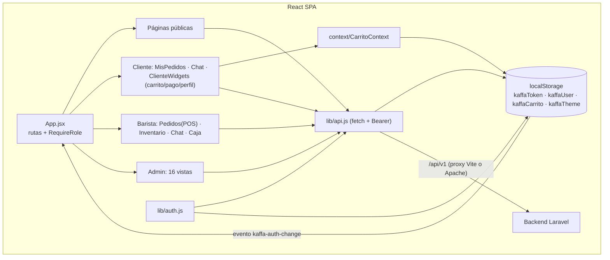
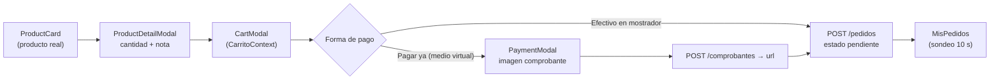

# 11 — Frontend (SPA React)

> **Fuente de verdad del frontend**: este documento. La arquitectura de alto nivel (contexto y despliegue) está en [`01-arquitectura.md`](01-arquitectura.md).

## 1. Tecnología

SPA en **React 19.2.8 + Vite 8** (JavaScript, sin TypeScript), sin librería de estado global ni cliente HTTP externo: `fetch` nativo envuelto en `src/lib/api.js`. Ver Tabla 1.

**Tabla 1.** Dependencias del frontend (`package.json`, resueltas por `pnpm-lock.yaml`).

| Paquete | Versión | Uso |
|---------|---------|-----|
| react / react-dom | 19.2.8 | UI |
| react-router-dom | 7.18.2 | Enrutamiento (`BrowserRouter`) |
| react-hook-form | 7.86.0 | Formularios (auth, POS, CRUDs) |
| sonner | 2.0.8 | Notificaciones toast |
| vite | 8.2.2 | Build/dev server |
| eslint | 10.x | Lint (sin tests automatizados) |

CDNs cargadas en tiempo de ejecución: Chart.js (gráficas del admin) [11], jsPDF 2.5.1 (recibos del barista) [10], Font Awesome 6 y Google Fonts Poppins (`index.html`).

## 2. Estructura de carpetas

```text
src/
├── main.jsx / App.jsx        entrada; ErrorBoundary + Toaster + rutas
├── pages/                    públicas · auth · cliente · dashboard-admin (16) · dashboard-barista (4)
├── components/               Layout (Navbar+Footer), RequireRole, ClienteWidgets (4 modales), ProductCard
├── context/                  CarritoContext (carrito, pago, perfil del cliente)
├── hooks/                    useCatalogo · useEquipo · useChatNoLeidos · useStyles · useBodyClass · useDashboardTheme
├── lib/                      api.js · auth.js · storage.js · toast.js · utils.js · stylesManager.js · productos-store.js
├── data/                     productos.js (catálogo demo)
└── styles/                   variables.css (tokens de tema claro/oscuro)
public/css/                   hojas por página cargadas en caliente (stylesManager.js)
```

## 3. Rutas y protección

Ver Tabla 2. Los dashboards usan `RequireRole` (`src/components/RequireRole.jsx`), que valida el token con `GET /me` y redirige a `/login` (sin sesión) o `/` (rol incorrecto). El panel admin cambia de sección por **estado interno** (`DashboardAdmin.jsx`, mapas `NAV`/`VIEWS`), no por URL; el panel barista sí usa rutas anidadas.

**Tabla 2.** Rutas de la SPA (`src/App.jsx`).

| Ruta | Acceso | Contenido |
|------|--------|-----------|
| `/`, `/menu`, `/eventos`, `/sobre-nosotros`, `/contacto` | público | sitio comercial; «Sobre Nosotros» incluye equipo por fecha/turno (`GET /equipo`) |
| `/login`, `/registro`, `/forgot-password`, `/reset-password`, `/verify-email` | público | autenticación |
| `/pedidos`, `/chat` | `RequireRole cliente` | mis pedidos y chat |
| `/admin-dashboard` | `RequireRole admin` | panel de 16 secciones |
| `/barista-dashboard/{pedidos,inventario,chat,caja}` | `RequireRole barista` | POS, inventario, chat, caja |
| `*` | — | redirección a `/` |

## 4. Diagrama de componentes y flujo de datos

**Figura 1.** Componentes principales y flujo de datos (contexto + almacenamiento local).



- **Estado**: no hay store global; el estado vive en `Context` (carrito) y en `localStorage` (sesión/tema). Los cambios de sesión se propagan con el evento de ventana `kaffa-auth-change` (lo escuchan `Navbar`, `Layout` y `CarritoContext` para limpiar carrito al cerrar sesión).
- **Token**: `api.js` lee `kaffaToken` y adjunta `Authorization: Bearer …`; ante **401** limpia token/usuario y el guard redirige a `/login`. No hay reintento/refresco automático (`/auth/refresh` existe en el backend pero la SPA no lo invoca — `[GAP]`).
- **Errores**: `ApiError` expone `status`, `errors` (bag de Laravel) y `code` de negocio; `Api.firstError()` muestra el primer mensaje; `Api.turnoMessage()` traduce los códigos de turno (`FUERA_HORARIO`, `TURNO_INACTIVO`, `TURNO_EXPIRADO`).

## 5. Sistema de estilos

- `src/styles/variables.css`: tokens CSS (paleta SENA, `--primary: #39A900`) con bloques claro/oscuro vía `[data-theme="dark"]`.
- `public/css/`: hojas por página (`auth.css`, `dashboard-admin.css`, `dashboard-base.css`, `style.css`, …) cargadas/descargadas en caliente por `stylesManager.js` con conteo de referencias (solo se inyecta el `<link>` mientras la página está montada); `useStyles` y `useBodyClass` lo orquestan por página.
- Tema del dashboard: `useDashboardTheme` persiste `kaffaTheme` en `localStorage`.

## 6. Catálogo demo vs. real

- **Real** (`useCatalogo`): `GET /productos?activo=1` + `GET /categorias`; normaliza a `{id, nombre, descripcion, imagen, precio, real:true, raw}`.
- **Demo** (`src/data/productos.js`, 10 productos/3 categorías con opciones de personalización): se usa si la API falla o devuelve vacío (`real:false`). Los productos demo **no son comprables** (`ProductCard` evita redirigir usuarios autenticados a `/login` para no crear bucles de login).
- `productos-store.js`: catálogo personalizado del cliente en `localStorage` (`kaffaProductosMenu`), hoy sin uso en el flujo API.

## 7. Sondeo (polling) y actualización de datos

Ver Tabla 3. No hay websockets; cada vista sondea el recurso correspondiente (respetando el throttle de 60 req/min del backend).

**Tabla 3.** Intervalos de sondeo por recurso.

| Recurso | Intervalo | Vista(s) |
|---------|-----------|----------|
| Pedidos | 10 s | `MisPedidos.jsx` (cliente), `PedidosView.jsx` (barista) |
| Chat / no leídos | 5 s | `ChatBarista.jsx`, `ChatView.jsx`, `SidebarBarista`, `useChatNoLeidos` (Navbar) |
| Insumos | 15 s | `InventarioView.jsx` |
| Cajas | 30 s | `CajaView.jsx` (el backend limita `/cajas` a 10 escrituras/min) |
| Turno activo | 60 s | `BaristaContext.jsx` |

## 8. Flujos destacados

**Figura 2.** Flujo de compra del cliente (carrito → pago con comprobante).



Reglas replicadas en la UI (espejo del backend): medio virtual exige comprobante; barista sin turno no puede cobrar ni mover estados; la suma de pagos debe igualar el total (±0.01); el admin puede abrir/cerrar caja sin turno; eliminar compras/mermas revierte el stock.

## 9. Varios

- **Dashboard barista**: encabezado con badge de turno y minutos restantes (`BaristaContext`), tema claro/oscuro, modal de perfil (`PUT /perfil`), logout con confirmación.
- **PDFs**: `helpers.js` carga jsPDF desde CDN; recibo de 80 mm por pedido e historial A4 de entregados.
- **Admin**: CSV de pedidos generado en cliente; gráficas con Chart.js (ingresos 7 días, top 5 productos).
- `[GAP]` El frontend no tiene suite de pruebas (solo ESLint) ni variables de entorno (`import.meta.env` sin uso; la base `/api/v1` es relativa).
