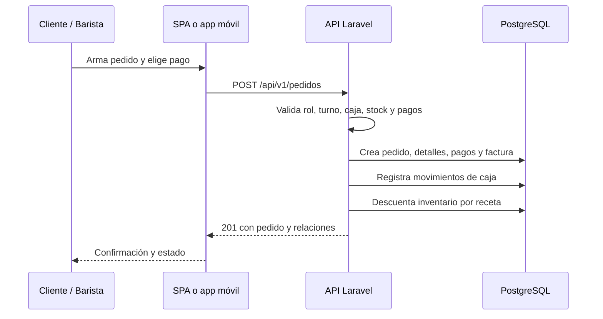

# 1. Contexto del sistema

KAFFA es un sistema de punto de venta (POS) para una cafetería. Su backend es una API REST en Laravel 10 que concentra las reglas de negocio y la persistencia; la interfaz web y la aplicación móvil son clientes desacoplados que consumen JSON.

Este capítulo explica **qué hace el sistema, quién lo usa y dónde termina su alcance**. Es la base para interpretar el resto del manual: si una decisión de código no encaja con el contexto descrito aquí, conviene revisarla antes de modificarla.

## 1.1 Problema de negocio

Una cafetería necesita operar de forma coordinada cuatro frentes que normalmente viven en hojas de cálculo separadas:

1. **Venta y cobro**: pedidos de mostrador y pedidos creados por clientes, con varios medios de pago y comprobantes.
2. **Inventario**: consumo de insumos por receta, compras a proveedores, mermas y stock mínimo.
3. **Caja**: apertura con base, movimientos automáticos por pagos y cierre con arqueo.
4. **Operación del personal**: turnos, permisos por rol, chat con clientes y reportes de novedades.

KAFFA integra esos frentes en una sola base de datos transaccional. El backend no “dibuja” pantallas: expone recursos y validaciones para que cualquier cliente (SPA, app móvil o integración futura) opere con las mismas reglas.

## 1.2 Actores y responsabilidades

**Tabla.** _Actores del sistema y sus permisos_

| Actor | Rol técnico | Qué puede hacer | Restricciones principales |
|---|---|---|---|
| Visitante | Sin autenticación | Ver menú, categorías, eventos publicados y equipo visible | Solo lectura; no ve insumos, recetas, pagos ni métricas |
| Cliente | `cliente` | Registrarse, verificar correo, iniciar sesión, crear pedidos propios, consultarlos, chatear y usar el Asistente | Solo ve sus pedidos; no puede cambiar estados ni operar caja |
| Barista | `barista` | POS de mostrador, cobros, compras, gastos, mermas, caja, chat y reportes | Requiere **turno activo** para mutar recursos operativos; solo opera su propia caja |
| Administrador | `admin` | Catálogo, usuarios, roles, turnos, eventos, facturas, supervisión y reportes | Exento de turno; token con ability `*`; no puede saltarse validaciones de negocio |

Un usuario puede tener **varios roles a la vez** (`usuario__rols`). Esto permite, por ejemplo, que una persona sea barista y cliente sin duplicar cuentas.

## 1.3 Módulos funcionales

**Tabla.** _Módulos funcionales del backend_

| Módulo | Propósito | Entidades principales |
|---|---|---|
| Autenticación | Registro público, verificación por OTP, login, refresh y recuperación | `users`, `registros_pendientes`, `codigos_otp`, `personal_access_tokens` |
| Catálogo | Menú vendible, composición por insumos y medios de pago | `categorias`, `productos`, `insumos`, `recetas`, `medio__pagos` |
| Pedidos y pagos | Ciclo de venta, cobro, comprobantes y factura | `pedidos`, `detalle__pedidos`, `pago__pedidos`, `factura__ventas` |
| Caja | Sesión de caja, movimientos y arqueo | `cajas`, `movimiento__cajas` |
| Compras | Abastecimiento y aumento de stock | `compras`, `detalle__compras`, `compra__pagos`, `proveedors` |
| Gastos | Egresos operativos | `gastos`, `gasto__pagos` |
| Mermas | Pérdidas de insumos y ajuste de stock | `mermas`, `insumos` |
| Turnos | Asignación de baristas y control de horario | `turnos`, `barista_turno` |
| Chat y reportes | Comunicación cliente↔personal y novedades | `mensajes`, `reportes` |
| Eventos | Contenido de la landing y Home móvil | `eventos`, `evento_imagenes` |
| Asistente KAFFA | Chatbot local con respuestas por rol | `asistente_mensajes` |

## 1.4 Flujo general de una venta

**Figura 1.** Flujo resumido de una venta. El detalle transaccional está en el capítulo 12.

## 1.5 Qué queda fuera del alcance

Para evitar expectativas incorrectas, el código **no** implementa:

- Pagos en línea reales: los medios “virtuales” son transferencias, QR o pagos móviles acreditados con un **comprobante** subido a Cloudinary.
- Facturación electrónica fiscal colombiana: la numeración es interna (`F{AÑO}{NNNNNN}`), sin DIAN.
- Websockets o tiempo real: la SPA usa sondeo (5–60 s).
- App Android/iOS nativa dentro de este repositorio: existe una especificación derivada, pero no un proyecto móvil.
- Docker, CI/CD o infraestructura como código: el repositorio no los incluye.
- Multisesión por cookies: la API es *pure bearer token*.

> **Recomendación.** Si el negocio necesita facturación electrónica o pagos en línea, conviene diseñarlos como módulos nuevos con idempotencia y conciliación, no como un parche sobre `PedidoService`.

## 1.6 Fuentes de verdad

**Tabla.** _Fuentes de verdad por dominio_

| Dominio | Fuente canónica |
|---|---|
| Endpoints | `backend-kaffa/routes/api.php` + `docs/openapi.json` |
| Base de datos | Migraciones + `docs/02-base-datos.md` |
| Reglas de negocio | Servicios (`app/Services`) + `docs/04-modulos.md` |
| Seguridad | Middleware, policies y `docs/05-seguridad.md` |
| Operación | `.env.example`, `config/*`, `docs/07-despliegue.md` |
| Pruebas | `backend-kaffa/tests` + `docs/08-pruebas.md` |

Cuando este manual y un README de aplicación discrepen, rige el código y la especificación OpenAPI. Los READMEs son resúmenes, no contratos.

## 1.7 Cómo está organizado el manual

- **Parte I (capítulos 1–2)**: contexto y arquitectura.
- **Parte II (3–7)**: requisitos, instalación, configuración, base de datos y servicios externos.
- **Parte III (8–9)**: modelo de datos y flujos de consistencia.
- **Parte IV (10–14)**: organización del código, seguridad, servicios, errores y concurrencia.
- **Parte V (15–26)**: referencia de la API y matriz completa de endpoints.
- **Parte VI (27–31)**: despliegue, operación, pruebas, troubleshooting y mantenimiento.
- **Parte VII (32)**: evaluación de la calidad del sistema frente a normas ISO.
- **Anexos**: plantilla de entorno, catálogo de endpoints, SQL, configuraciones de servidor, errores y referencias.

> **Nota.** Los ejemplos de este manual usan datos ficticios. Nunca se reproducen contraseñas, claves SMTP, secretos de Cloudinary ni credenciales de producción.
