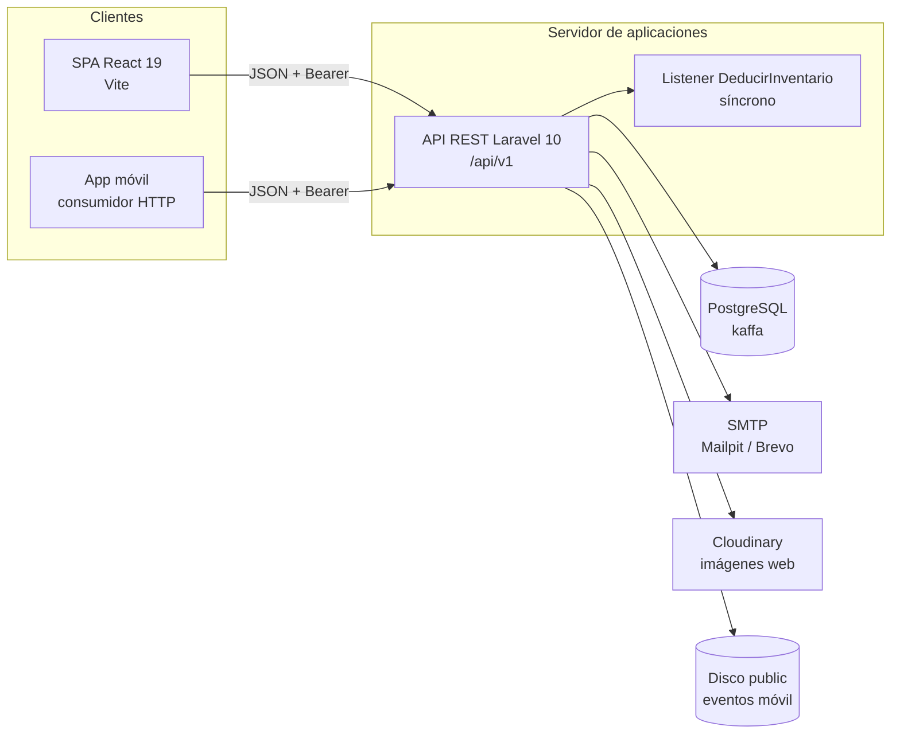
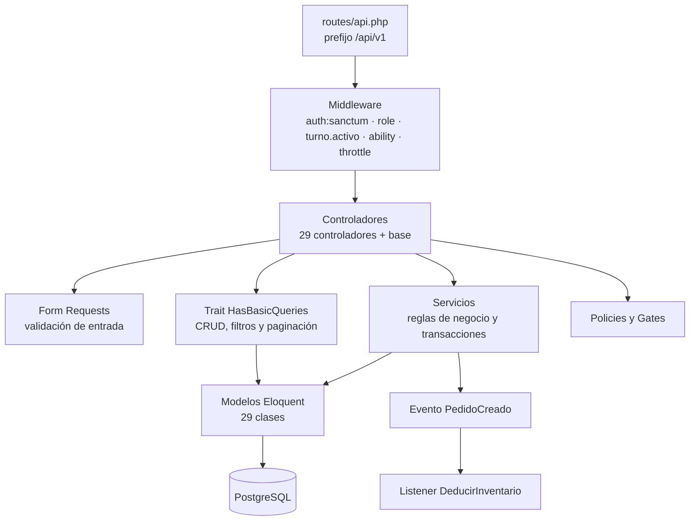
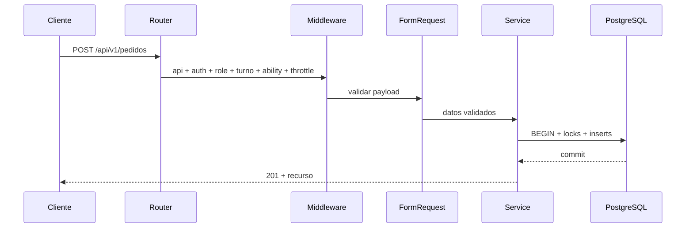
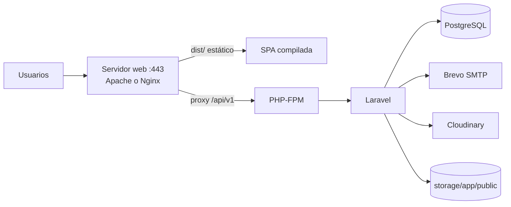

# 2. Arquitectura del sistema

KAFFA usa una arquitectura **desacoplada cliente-servidor**. El backend no renderiza la aplicación: expone una API JSON versionada en `/api/v1`; la SPA y la app móvil son consumidores independientes. Esta separación permite cambiar la interfaz sin tocar las reglas de negocio y probar la API con `curl`, Postman o cualquier cliente HTTP.

## 2.1 Vista de contexto



**Figura 1.** Contexto de despliegue lógico. Cloudinary recibe las imágenes desde el cliente web; el backend solo valida la URL. La excepción es `POST /eventos/imagen`, que guarda el archivo en el disco `public`.

## 2.2 Stack verificado

**Tabla.** _Stack tecnológico verificado_

| Componente | Versión / requisito | Evidencia |
|---|---|---|
| PHP | `^8.1` (el entorno auditado usa 8.5.11) | `composer.json` |
| Laravel | `10.50.x` | `composer.lock` |
| Sanctum | `3.3.x` | `composer.json` |
| PostgreSQL | 13+ recomendado; auditado con 18.6 | `.env.example`, `phpunit.xml` |
| Composer | 2.x | `composer.lock` |
| Node.js | 20+ recomendado; auditado con 24.19 | frontend |
| pnpm | gestor del frontend | `pnpm-lock.yaml` |
| PHPUnit | `^10.1` | `composer.json` |
| Scramble | `^0.13` (solo dev) | `composer.json` |

El backend **no** usa Redis, colas externas ni WebSockets por defecto. `QUEUE_CONNECTION=sync` y `CACHE_DRIVER=file` son suficientes para desarrollo; producción puede escalar a Redis sin cambiar el código.

## 2.3 Capas del backend



**Figura 2.** Capas del backend. La autorización se aplica en tres niveles: middleware de ruta, policies/gates y scopes de consulta.

**Tabla.** _Capas del backend y responsabilidades_

| Capa | Responsabilidad | Ejemplo |
|---|---|---|
| Rutas | Declarar endpoint, método, middleware y nombre | `routes/api.php` |
| Middleware | Autenticación, rol, turno, ability y throttle | `CheckRole`, `EnsureActiveTurno` |
| Form Requests | Validar tipos, longitudes y reglas condicionales | `StorePedidoRequest` |
| Controladores | Orquestar entrada/salida HTTP; delegan reglas | `PedidoController` |
| Servicios | Transacciones, stock, caja, facturación | `PedidoService` |
| Modelos | Persistencia, relaciones, casts, scopes | `Pedido`, `Caja` |
| Policies/Gates | Autorización fina por registro | `PedidoPolicy` |
| Recursos | Serialización uniforme y ocultamiento de datos | `BaseResource` |
| Eventos/Listeners | Efectos secundarios desacoplados | `PedidoCreado` → `DeducirInventario` |

## 2.4 Ciclo de una petición

1. El cliente envía `https://host/api/v1/recurso` con `Authorization: Bearer {token}`.
2. El grupo `api` aplica el throttle global de 60/min por usuario o IP.
3. `auth:sanctum` valida el token y carga el usuario.
4. `role:` comprueba que el usuario tenga alguno de los roles permitidos.
5. `turno.activo` se aplica solo a baristas y valida horario/asignación.
6. `ability:` comprueba que el token tenga el alcance requerido.
7. El Form Request valida el cuerpo; si falla, responde 422 con el *bag* de errores.
8. El controlador llama al servicio o al trait de consulta.
9. El servicio abre una transacción, bloquea filas críticas y aplica reglas.
10. El modelo persiste; los eventos síncronos ejecutan efectos (descuento de stock).
11. `BaseResource` serializa y oculta campos sensibles.
12. El `Handler` transforma excepciones en JSON uniforme.



**Figura 3.** Ciclo de una petición de escritura.

## 2.5 Estructura de carpetas

```text
backend-kaffa/
├── app/
│   ├── Events/                 PedidoCreado
│   ├── Exceptions/             BusinessRuleException, Handler
│   ├── Http/
│   │   ├── Controllers/        29 controladores de dominio + `Controller` base
│   │   ├── Middleware/         CheckRole, EnsureActiveTurno, EnsureTokenCanAbility
│   │   ├── Requests/           Store*/Update* por recurso
│   │   └── Resources/          BaseResource
│   ├── Listeners/              DeducirInventario
│   ├── Mail/                   CodigoOtpMail
│   ├── Models/                 29 modelos + Concerns/HasBasicQueries
│   ├── Policies/               17 policies de dominio + BasePolicy
│   ├── Providers/              AuthServiceProvider, RouteServiceProvider
│   ├── Rules/                  CloudinaryUrl
│   └── Services/               10 servicios de negocio
├── config/                     app, auth, cors, database, mail, otp, sanctum, services
├── database/
│   ├── factories/              UserFactory
│   ├── migrations/             44 migraciones
│   └── seeders/                Rol, MedioPago, User, Turno, Catalog
├── routes/api.php              API versionada
├── storage/app/public/eventos  imágenes subidas desde móvil
├── tests/Feature/              13 archivos de pruebas
└── .env.example                plantilla de configuración
```

**Figura 4.** Estructura del backend.

## 2.6 Decisiones de diseño relevantes

### 2.6.1 API versionada por prefijo

El prefijo `api/v1` se declara en `RouteServiceProvider`. No hay negociación por cabecera ni versionado en el dominio. Para una ruptura incompatible, se recomienda crear `api/v2` y mantener `v1` durante una ventana de transición.

### 2.6.2 Token Bearer puro

La API no usa sesiones por cookies ni CSRF. `EnsureFrontendRequestsAreStateful` está comentado en `Kernel.php`; `supports_credentials` es `false`. Esto simplifica clientes móviles y evita depender de dominios stateful de Sanctum. La contrapartida es que el token debe protegerse en el cliente (almacenamiento seguro, HTTPS, expiración).

### 2.6.3 Lógica de negocio en servicios

Los controladores son delgados. Las operaciones que cruzan varias tablas (pedido, compra, gasto, merma, factura, turno) viven en `app/Services` y se ejecutan dentro de `TransactionService::run`, que reintenta ante deadlocks. Esto evita duplicar reglas entre web y móvil.

### 2.6.4 Autorización en profundidad

No basta con `role:`. Las rutas de escritura exigen `ability:` y los modelos aplican policies/gates. Los scopes (`Pedido::scopeByUser`, `CajaPolicy`, `FacturaVentaPolicy`) limitan los datos que un cliente o barista puede ver. Esta triple barrera está documentada en el capítulo 11.

### 2.6.5 Soft delete selectivo

Las entidades de negocio conservan `deleted_at`; las tablas de detalle y movimientos se borran físicamente cuando el servicio lo decide. El soft delete no restaura stock por sí solo: `PedidoService::eliminar` no repone inventario, mientras que `CompraService` y `MermaService` sí revierten sus efectos. Es una decisión deliberada que el operador debe conocer.

### 2.6.6 Imágenes: dos caminos

- **Web**: el navegador sube a Cloudinary con un preset *unsigned*; el backend recibe y valida la `secure_url` con `App\Rules\CloudinaryUrl`.
- **Móvil**: `POST /eventos/imagen` recibe multipart, guarda en `storage/app/public/eventos` y devuelve una URL absoluta.

No hay endpoint genérico de subida de comprobantes. Si se migra a subidas firmadas, el backend debe emitir la firma y nunca exponer el API secret.

## 2.7 Integración con los clientes

**Tabla.** _Integración del backend con la SPA y la app móvil_

| Aspecto | SPA web | App móvil |
|---|---|---|
| Base URL | `/api/v1` relativa, proxy Vite o Apache | URL absoluta del backend |
| Autenticación | `Authorization: Bearer` | Igual |
| Persistencia del token | `localStorage` (`kaffaToken`) | Almacenamiento seguro del sistema |
| Actualización de datos | Sondeo 5–60 s | Puede usar sondeo o refresh manual |
| Catálogo público | `GET /productos`, `/categorias` sin sesión | Igual, para Home de invitado |
| Imágenes | Cloudinary directo | Cloudinary o `POST /eventos/imagen` |
| Errores | Lee `message`, `errors` y `code` | Igual; útil para `FUERA_HORARIO`, `TOKEN_SIN_ABILITY` |

> **Recomendación.** Ningún cliente debe replicar reglas de negocio críticas (stock, suma de pagos, arqueo). Puede anticiparlas para mejorar la experiencia, pero el backend siempre debe validarlas.

## 2.8 Topología de desarrollo y producción

**Desarrollo verificado**

```text
:5173  Vite dev server (SPA)
:8000  php artisan serve (API)
:5432  PostgreSQL (kaffa)
:1025  Mailpit SMTP (opcional)
:8025  Mailpit UI (opcional)
```

**Producción prevista**



**Figura 5.** Topología de producción recomendada. No hay evidencia de un despliegue real en el repositorio; el capítulo 27 detalla los pasos.

## 2.9 Restricciones y riesgos arquitectónicos

**Tabla.** _Riesgos arquitectónicos y mitigaciones_

| Riesgo | Impacto | Mitigación |
|---|---|---|
| Sin websockets | La UI puede mostrar datos con retraso | Sondeo configurable; no reducir por debajo del throttle |
| `QUEUE_CONNECTION=sync` | El envío de correo bloquea la petición | `MAIL_TIMEOUT=10`; en producción usar cola Redis |
| Cloudinary *unsigned* | Cualquiera con el preset puede subir archivos | Restringir preset, monitorear cuota, migrar a firma |
| Token en `localStorage` | Robo por XSS | CSP, sanitización, HTTPS, expiración corta y refresh |
| Sin idempotencia en pedidos | Un reintento de red puede duplicar una venta | Implementar `Idempotency-Key` en el futuro |
| Stock descontado por evento síncrono | Si el listener falla, la transacción se revierte | Mantener el listener dentro de la transacción y probar |
| Factura interna | No sirve como documento fiscal | Integrar proveedor autorizado si se requiere |

> **Advertencia.** El sistema es robusto para la operación de una cafetería, pero no es un ERP fiscal. No se debe prometer cumplimiento tributario sin un módulo de facturación electrónica certificado.

> **Evaluación de calidad.** La descripción arquitectónica de este capítulo se compara con ISO/IEC/IEEE 42010 en el capítulo 32 (§32.7).
