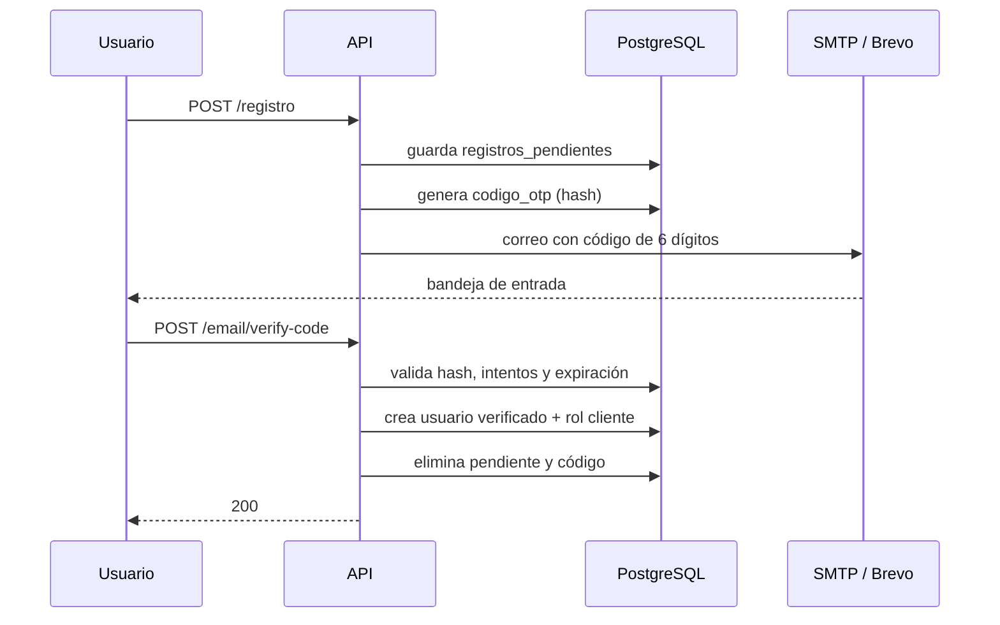
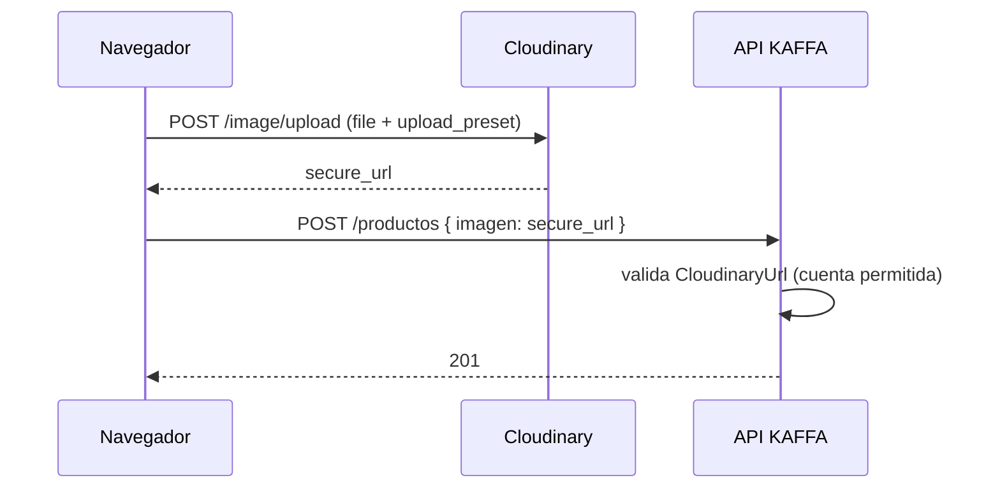

# 7. Servicios externos

El backend depende de servicios externos para dos funciones críticas: **enviar códigos OTP** (registro y recuperación) y **alojar imágenes**. Este capítulo explica el contrato de cada servicio, cómo se configura, qué falla y cómo diagnosticarlo.

## 7.1 Mapa de dependencias

**Tabla.** _Mapa de dependencias externas_

| Servicio | Función | Protocolo | ¿Crítico? |
|---|---|---|---|
| SMTP / Brevo | Correos con códigos OTP | SMTP | Sí para altas y reseteos |
| Mailpit | Captura de correos en desarrollo | SMTP/HTTP | Solo desarrollo |
| Cloudinary | Imágenes web (productos, eventos, fotos, comprobantes) | HTTPS | Sí para flujo web con imágenes |
| Disco `public` | Imágenes de eventos subidas desde móvil | HTTP multipart | Solo para esa función |
| Gemini | LLM externo (reservado) | HTTPS | No; no se usa |
| CDNs del frontend | Chart.js, jsPDF, Font Awesome, Poppins | HTTPS | No; afecta la UI, no la API |

## 7.2 Correo transaccional

### 7.2.1 Flujo de un código OTP



**Figura 1.** Verificación de correo por OTP. El código nunca se guarda en claro.

### 7.2.2 Reglas del código

**Tabla.** _Reglas y valores por defecto del código OTP_

| Regla | Valor por defecto | Fuente |
|---|---|---|
| Longitud | 6 dígitos | `OTP_LENGTH` |
| Vigencia | 15 minutos | `OTP_EXPIRA_MINUTOS` |
| Intentos | 5 | `OTP_MAX_INTENTOS` |
| Reenvío | 60 segundos | `OTP_REENVIO_SEGUNDOS` |
| Almacenamiento | Hash | `OtpService` |
| Uso | Un solo uso | Se elimina al validar |
| Pendiente | 24 horas | `RegistrationService::purgarAntiguos` |

### 7.2.3 Mailpit en desarrollo

```env
MAIL_MAILER=smtp
MAIL_HOST=127.0.0.1
MAIL_PORT=1025
```

Interfaz: `http://localhost:8025`. Si Mailpit está en Docker y el backend en el host, publique `1025:1025` y `8025:8025`. Si el backend está en otra red, use el nombre del contenedor (`mailpit`).

Alternativa sin servidor:

```env
MAIL_MAILER=log
```

El código aparece en `storage/logs/laravel.log`. No use esta opción en producción.

### 7.2.4 Brevo en producción

Checklist:

1. Crear cuenta y verificar el remitente (`Senders & IP → Senders`).
2. Generar una **SMTP key** (`SMTP & API → SMTP`), no una API key.
3. Configurar `MAIL_USERNAME` con el login SMTP (`<id>@smtp-brevo.com`).
4. Usar `smtp-relay.sendinblue.com:587` con `tls`.
5. Enviar un correo de prueba antes de abrir el registro al público.

```bash
php artisan tinker --execute="Mail::raw('Prueba KAFFA', fn(\$m) => \$m->to('tu-correo@example.com')->subject('Prueba SMTP'));"
```

### 7.2.5 Fallos típicos

**Tabla.** _Fallos típicos del correo transaccional_

| Síntoma | Causa | Solución |
|---|---|---|
| `Connection could not be established` | Host/puerto incorrectos o firewall | Probar `telnet host 587` |
| `Peer certificate CN ... did not match` | Nodo regional de Brevo con CN distinto | Usar `smtp-relay.sendinblue.com`; no desactivar TLS |
| `535 Authentication failed` | SMTP key incorrecta o usuario mal formado | Regenerar credenciales |
| El correo llega a spam | Remitente no verificado/DKIM | Verificar dominio y remitente en Brevo |
| El registro responde 201 pero no llega nada | `MAIL_MAILER=log` o error silenciado | Revisar `storage/logs/laravel.log` |
| Timeout en registro | SMTP lento y cola `sync` | `MAIL_TIMEOUT=10`; usar cola Redis |

> **Advertencia.** El registro captura excepciones de envío y responde 201 para no filtrar información. Eso significa que un fallo de correo **no** se ve en la respuesta HTTP; solo en logs. Monitoree `storage/logs` o configure alertas.

## 7.3 Cloudinary

### 7.3.1 Modelo de subida



**Figura 2.** Subida web: el archivo no pasa por el backend.

### 7.3.2 Configuración

```env
CLOUDINARY_CLOUD_NAME=roffd6et
CLOUDINARY_UPLOAD_PRESET=KAFFACCYS
CLOUDINARY_FOLDER=samples/ecommerce
```

El frontend usa `VITE_CLOUDINARY_CLOUD_NAME` y `VITE_CLOUDINARY_UPLOAD_PRESET`. Son valores públicos por diseño; el **API secret** nunca debe llegar al navegador.

### 7.3.3 Validación en el backend

`App\Rules\CloudinaryUrl`:

- Acepta URLs `https://res.cloudinary.com/<cloud>/...`.
- Exige que `<cloud>` coincida con `CLOUDINARY_CLOUD_NAME` (o el configurado).
- Rechaza otras cuentas y esquemas no HTTPS.
- Se usa en productos, eventos, foto de perfil y comprobantes.

Si la regla falla, el Form Request responde 422. No hay excepción para URLs de Unsplash u otros dominios: las imágenes heredadas deben migrarse o permitirse explícitamente en la regla.

### 7.3.4 Riesgos del preset unsigned

- Cualquiera con el preset puede subir archivos.
- Se puede consumir la cuota o llenar la cuenta con contenido no deseado.
- No hay control de usuario en Cloudinary.

Mitigaciones:

1. Restringir formatos y tamaño en el preset.
2. Usar una carpeta dedicada.
3. Monitorear uso y alertas de cuota.
4. Migrar a subida firmada: el backend genera `signature` y `timestamp` con el API secret; el navegador sube con esos valores.
5. Validar en el backend que la URL pertenece a la cuenta (ya implementado).

## 7.4 Disco público para eventos móviles

`POST /eventos/imagen` es la única ruta que recibe un archivo:

```bash
curl -X POST https://api.kaffa.example/api/v1/eventos/imagen \
  -H "Authorization: Bearer $TOKEN" \
  -F "imagen=@evento.jpg"
```

Respuesta:

```json
{ "url": "https://api.kaffa.example/storage/eventos/abc123.jpg" }
```

Requisitos:

- `php artisan storage:link`.
- Permisos de escritura en `storage/app/public/eventos`.
- Validación de tipo y tamaño (≤ 5 MB).
- El cliente debe persistir la URL devuelta en `imagenes[]` del evento.

> **Advertencia.** Si el servidor se reconstruye sin respaldar `storage/app/public/eventos`, las imágenes móviles se pierden aunque la base conserve la URL.

## 7.5 Gemini (reservado)

El Asistente KAFFA actual es **local**: interpreta intenciones por palabras clave y consulta la base. No llama a Gemini. Las variables `GEMINI_*` existen en `config/services.php` y `.env.example` para una integración futura, pero no se usan.

Si se conecta un LLM:

- Enviar solo métricas agregadas, nunca datos personales.
- Aplicar timeout y fallback.
- No registrar prompts con datos sensibles.
- Documentar el proveedor y el tratamiento de datos.
- Evaluar costos y latencia.

## 7.6 CDNs del frontend

La SPA carga Chart.js, jsPDF, Font Awesome y Google Fonts desde CDN. Esto no afecta al backend, pero sí a la disponibilidad de la interfaz. Si la cafetería opera con internet inestable, considere empaquetar esas dependencias en el build.

## 7.7 Matriz de fallos y degradación

**Tabla.** _Matriz de fallos y degradación por servicio_

| Servicio caído | Efecto | Degradación posible |
|---|---|---|
| SMTP | No se envían OTP; registro/reseteo incompletos | Responder 201 y reintentar; monitorear logs |
| Cloudinary | No se suben imágenes web | Permitir URL manual temporal; no bloquear ventas en efectivo |
| Disco `public` | No se suben imágenes móviles | Usar Cloudinary o posponer la imagen |
| PostgreSQL | API no responde | Sin operación; restaurar servicio |
| Redis (si se usa) | Caché/colas fallan | Volver a `file`/`sync` temporalmente |
| Gemini | Sin efecto | El Asistente sigue local |

## 7.8 Checklist de servicios externos

- [ ] Correo de prueba recibido en Mailpit/Brevo.
- [ ] Remitente verificado en Brevo.
- [ ] `MAIL_TIMEOUT` definido.
- [ ] Cloudinary con preset restringido.
- [ ] `CLOUDINARY_API_SECRET` fuera del frontend.
- [ ] `storage:link` creado y respaldado.
- [ ] Alertas de cuota de Cloudinary.
- [ ] Variables `GEMINI_*` vacías si no se usan.
- [ ] Documentación de contacto de cada proveedor.
