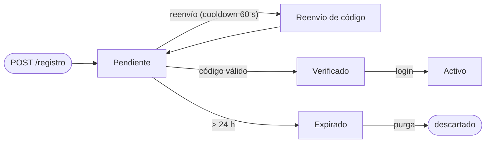
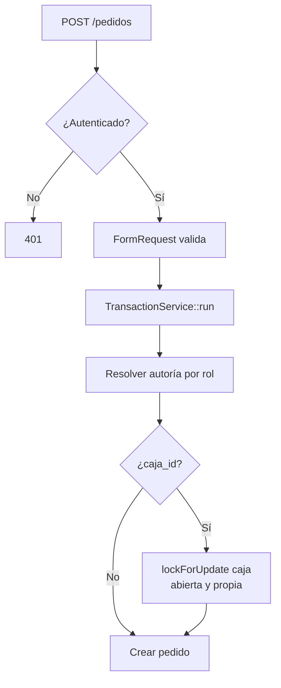
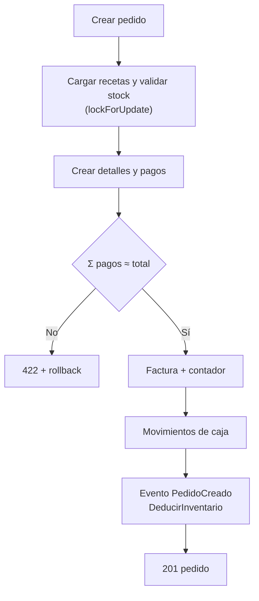
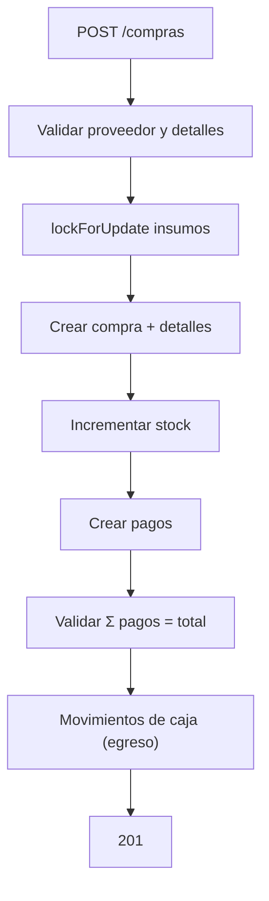
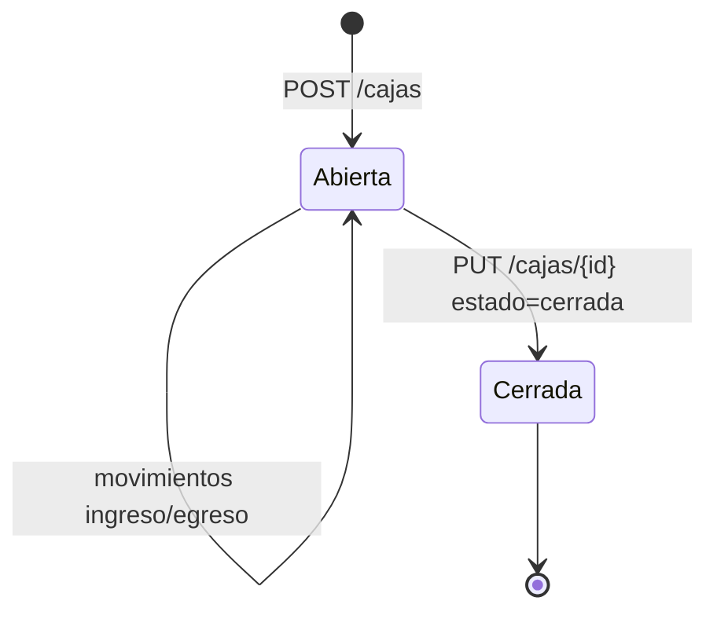

# 9. Flujos de datos y consistencia

Este capítulo describe **cómo se mueven los datos** entre módulos y qué garantías ofrece el backend. Es la lectura obligatoria antes de modificar `PedidoService`, `CompraService`, `Caja` o `FacturaService`.

## 9.1 Alta diferida y verificación



**Figura 1.** Ciclo de un alta de cliente.

**Tabla.** _Pasos del alta diferida de clientes_

| Paso | Tabla | Efecto |
|---|---|---|
| Registro | `registros_pendientes` | Guarda nombre, correo y contraseña hasheada |
| Código | `codigos_otp` | Hash, expiración, intentos y `enviado_at` |
| Verificación | `users`, `usuario__rols` | Crea usuario verificado con rol `cliente`; elimina pendiente y código |
| Reenvío | `codigos_otp` | Reemplaza el código si pasó el cooldown |
| Purga | `registros_pendientes` | Elimina pendientes > 24 h |

La contraseña se hashea con el cast `hashed` de `RegistroPendiente` y de `User`. Nunca se guarda en claro.

## 9.2 Pedido: del carrito al inventario



**Figura 2A.** Validación y autorización de un pedido.



**Figura 2B.** Persistencia y efectos de un pedido.

### 9.2.1 Autoría

**Tabla.** _Autoría de un pedido según rol_

| Rol | `cliente_id` | `barista_id` | `estado` |
|---|---|---|---|
| Cliente | Forzado a su ID | `null` | Forzado a `pendiente` |
| Barista | Opcional (cliente existente) | Forzado a su ID | El enviado, por defecto `pendiente` |
| Admin | Libre | Libre | Libre |

El cliente **no puede** crear un pedido a nombre de otro ni marcarlo como pagado. El barista firma el pedido de mostrador. El admin puede corregir autoría en backoffice.

### 9.2.2 Caja

Si se envía `caja_id`:

- La caja debe existir (`CAJA_NO_EXISTE`).
- Debe estar `abierta` (`CAJA_CERRADA`).
- Un barista solo puede usar una caja que él abrió (`CAJA_AJENA`).
- Se bloquea con `lockForUpdate` para evitar dos cierres simultáneos.

Cada pago genera un `movimiento__cajas` de tipo `ingreso`.

### 9.2.3 Stock

1. Se cargan los productos con `insumos` (recetas).
2. Se agrega el consumo por insumo: `cantidad_detalle × receta.cantidad`.
3. Se bloquean los insumos afectados con `lockForUpdate`.
4. Si `stock_actual < consumo`, se lanza `Stock insuficiente...` y se revierte todo.
5. Al crear el pedido, el evento `PedidoCreado` ejecuta `DeducirInventario`, que hace un `UPDATE` atómico con `GREATEST(0, stock_actual - ?)`.

La validación previa evita vender sin stock; el `GREATEST` evita valores negativos si algo cambia entre la validación y el descuento. La operación completa está en una transacción.

### 9.2.4 Pagos

- `pagos[].monto ≥ 0.01`.
- La suma debe coincidir con el total (±0.01).
- Estado `pagado` exige al menos un pago.
- Medio virtual (`es_virtual=true`) exige `comprobante_url` validada con `CloudinaryUrl`.
- El comprobante se guarda como URL; el archivo vive en Cloudinary.

### 9.2.5 Factura

Si se envía `factura`, el servidor:

1. Genera `numero_factura` con `FacturaService::generarNumeroFactura()`.
2. Hace UPSERT del contador `(nombre, año)`.
3. Bloquea la fila con `lockForUpdate`.
4. Incrementa `valor`.
5. Formatea `F{AÑO}{NNNNNN}`.

El cliente no puede imponer el número. La transacción evita huecos y duplicados.

### 9.2.6 Eliminación

`PedidoService::eliminar`:

- Borra detalles (hard delete).
- Borra movimientos de caja vinculados a sus pagos.
- Borra pagos y factura.
- Hace soft delete del pedido.
- **No restaura stock**.

> **Advertencia.** Eliminar un pedido no revierte el inventario. Si fue un error, el operador debe registrar una merma o un ajuste autorizado, no borrar y recrear a ciegas.

## 9.3 Compra: aumento de stock y egreso



**Figura 3.** Registro de una compra.

Reglas:

- `detalles` es obligatorio y debe tener al menos una línea.
- Cada detalle incrementa `stock_actual` del insumo.
- La suma de pagos debe coincidir con `total_compra` (±0.01).
- Cada pago genera un egreso de caja si se usa caja.
- Al eliminar la compra, se revierte el stock; si quedaría negativo, la operación falla.

## 9.4 Gasto y merma

**Gasto**: registra un egreso operativo. `usuario_id` se fuerza al autenticado; los pagos y movimientos se crean en la misma transacción. Al eliminar, se limpian pagos y movimientos.

**Merma**: reduce stock con motivo y responsable. Bloquea el insumo, valida que la cantidad no supere el stock y descuenta. Al eliminar, restaura el stock.

**Tabla.** _Efecto de cada operación sobre stock, caja y autoría_

| Operación | Stock | Caja | Autoría |
|---|---|---|---|
| Compra | Aumenta | Egreso | Proveedor |
| Gasto | No cambia | Egreso | Usuario autenticado |
| Merma | Disminuye | No cambia | Usuario autenticado |
| Venta | Disminuye | Ingreso | Cliente/barista |

## 9.5 Caja y arqueo



**Figura 4.** Ciclo de una caja.

### 9.5.1 Apertura

El cliente envía:

```json
{
  "monto_apertura_fisico": 100000,
  "monto_apertura_efectivo": 80000,
  "monto_apertura_digital": 20000
}
```

El servidor fija:

- `abierta_por = Auth::id()`.
- `estado = abierta`.
- `fecha_apertura = now()`.
- `turno_id = turno activo` (barista) o `null` (admin).
- `monto_apertura_sistema = monto_apertura_fisico` si no se envía.

### 9.5.2 Cierre

El cliente envía `estado='cerrada'` y los montos declarados. El servidor:

```text
monto_cierre_sistema = monto_apertura_sistema
                     + Σ ingresos
                     - Σ egresos
```

Fija `cerrada_por` y `fecha_cierre`. El cliente **no puede** enviar `monto_cierre_sistema`; se ignora y se recalcula.

Diferencia de arqueo:

```text
diferencia = monto_cierre_fisico - monto_cierre_sistema
```

- `0`: perfecto.
- Negativa: faltante.
- Positiva: sobrante.

### 9.5.3 Eliminación

No se puede eliminar una caja con movimientos (`422`). Primero deben anularse o trasladarse los movimientos con autorización.

## 9.6 Turnos

Un turno cubre un rango `[fecha, fecha_fin]`. Si `fecha_fin` es nula o igual a `fecha`, dura un día.

**Tabla.** _Horarios de los tipos de turno_

| Tipo | Horario |
|---|---|
| `mañana` | 07:00–13:00 |
| `tarde` | 13:00–18:00 |
| `abierto` | 05:00–22:00 |

`TurnoService::getActiveTurno`:

1. Calcula hora y fecha en `America/Bogota`.
2. Si está en 05:00–22:00 y el barista tiene un turno `abierto` que cubre hoy, lo devuelve (prioridad).
3. Si no, determina `mañana`/`tarde` por hora.
4. Busca un turno del tipo correspondiente que cubra la fecha.

Fuera de horario, el middleware responde `FUERA_HORARIO`; sin asignación, `TURNO_INACTIVO`; si el turno ya terminó, `TURNO_EXPIRADO`.

## 9.7 Asistente KAFFA

El Asistente es local:

1. Persiste el mensaje del usuario.
2. Normaliza la pregunta y detecta intención por palabras clave.
3. Consulta la base según el rol:
   - Admin: ventas, productos, inventario, pedidos, gastos, predicción y promociones.
   - Barista: ventas, productos, inventario y pedidos.
   - Cliente: menú, medios de pago, cómo pedir, eventos y sede.
4. Persiste la respuesta.
5. Devuelve `{respuesta, mensaje_id, created_at}`.

No hay llamada externa; si se conecta un LLM, debe mantenerse el aislamiento por rol y usuario.

## 9.8 Invariantes del sistema

**Tabla.** _Invariantes del sistema y dónde se garantizan_

| Invariante | Dónde se garantiza |
|---|---|
| Un pedido facturado tiene número único | `factura__ventas.numero_factura` + `FacturaService` |
| No se vende sin stock | Validación previa + transacción |
| No se opera una caja ajena | `PedidoService`, `CompraService`, `GastoService` |
| No se cierra una caja con arqueo falseado | `Caja::actualizarRegistro` |
| No se elimina una caja con movimientos | `Caja::eliminarRegistro` |
| Un cliente solo ve sus pedidos | `Pedido::scopeByUser` |
| Un barista solo muta en turno | `EnsureActiveTurno` |
| Un token no muta fuera de su ability | `EnsureTokenCanAbility` |

> **Recomendación.** Cualquier nuevo módulo que toque stock, caja o facturas debe reutilizar `TransactionService` y `lockForUpdate`. No implemente “un pedido rápido” por fuera de `PedidoService`.
