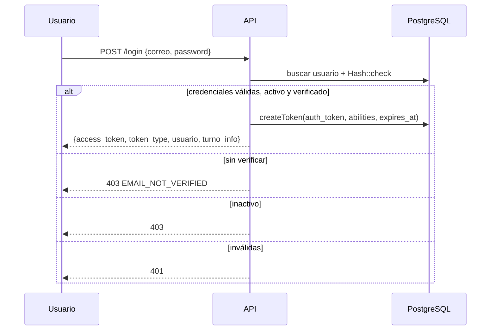

# 11. Autenticación y seguridad

Este capítulo describe los mecanismos **implementados y verificados**. No es una certificación ni un pentest: es una guía para entender cómo se protege la API y qué debe revisarse antes de exponerla.

## 11.1 Modelo de autenticación

KAFFA usa **tokens personales de Sanctum**:

- El cliente envía `Authorization: Bearer {token}`.
- El token se crea en `POST /login` y se guarda hasheado en `personal_access_tokens`.
- No hay sesiones por cookies ni CSRF en la API.
- `EnsureFrontendRequestsAreStateful` está comentado; la API es *pure bearer token*.
- `SANCTUM_EXPIRATION=1440` fija 24 horas por defecto.



**Figura 1.** Login y emisión de token.

## 11.2 Registro y verificación por OTP

**Tabla.** _Flujo de registro y verificación por OTP_

| Paso | Endpoint | Efecto |
|---|---|---|
| 1 | `POST /registro` | Guarda pendiente, envía código; **no** crea usuario |
| 2 | `POST /email/verify-code` | Valida código y crea usuario verificado con rol `cliente` |
| 3 | `POST /email/verification-notification` | Reenvía código (cooldown 60 s) |
| 4 | `POST /login` | Exige `email_verified_at` no nulo |

Propiedades:

- Código de 6 dígitos, hasheado, un solo uso.
- Expira en 15 minutos; máximo 5 intentos; reenvío cada 60 s.
- Pendientes > 24 h se purgan.
- Respuesta uniforme en reenvío para evitar enumeración.
- Usuarios creados por admin nacen verificados.

> **Advertencia.** El registro responde 201 aunque el envío de correo falle (se registra en logs). Monitoree los fallos de SMTP: un usuario puede quedar pendiente sin recibir el código.

## 11.3 Sesión y revocación

**Tabla.** _Endpoints de sesión y revocación de tokens_

| Endpoint | Efecto |
|---|---|
| `POST /logout` | Revoca el token actual |
| `POST /auth/refresh` | Revoca el actual y emite uno nuevo |
| `POST /auth/logout-all` | Revoca todos los tokens del usuario |
| `POST /reset-password` | Cambia contraseña y revoca todos los tokens |

La rotación con `refresh` permite sesiones largas sin re-login. La SPA actual **no** invoca `refresh`; si el token expira, el usuario debe volver a iniciar sesión. Es un `[GAP]` de integración, no del backend.

## 11.4 Roles

Tres roles sembrados:

**Tabla.** _Roles del sistema_

| Rol | Descripción |
|---|---|
| `admin` | Acceso total; token con ability `*` |
| `barista` | Operación POS con turno activo |
| `cliente` | Autoservicio |

Un usuario puede tener varios roles. `User::hasRole()` consulta la pivote `usuario__rols`. El middleware `role:` acepta una lista separada por comas y exige **alguno**.

Respuestas:

- Sin token: `401 {"message":"No autenticado."}`.
- Sin rol: `403 {"message":"No tienes permiso para realizar esta acción."}`.

## 11.5 Abilities

Las abilities se acuñan en `AuthController::abilitiesFor`:

**Tabla.** _Abilities asignadas a cada rol_

| Rol | Abilities |
|---|---|
| Admin | `*` |
| Barista | `pedidos:manage`, `compras:manage`, `gastos:manage`, `mermas:manage`, `cajas:manage`, `movimiento-cajas:read`, `proveedores:read`, `catalogo:read`, `turnos:read` |
| Cliente | `catalogo:read`, `pedidos:create`, `pedidos:read` |

El middleware `ability:` acepta varias abilities separadas por coma y exige **alguna**. Si el token no la posee:

```json
{
  "message": "Tu token no tiene el permiso requerido para esta acción.",
  "code": "TOKEN_SIN_ABILITY",
  "required_ability": ["pedidos:manage"]
}
```

> **Nota de migración.** Los tokens emitidos antes de un cambio de abilities conservan las antiguas. El usuario debe reautenticarse o rotar con `POST /auth/refresh`.

## 11.6 Matriz RBAC resumida

**Tabla.** _Matriz RBAC resumida_

| Capacidad | Admin | Barista | Cliente |
|---|:---:|:---:|:---:|
| Catálogo: lectura | ✔ | ✔ | ✔ (categorías/productos sin sesión) |
| Catálogo: escritura | ✔ | — | — |
| Eventos: lectura | ✔ | ✔ | ✔ (publicados) |
| Eventos: gestión | ✔ | — | — |
| Usuarios/roles/turnos/facturas | ✔ | — | — |
| Pedidos: ver | Todos | Todos | Solo propios |
| Pedidos: crear | ✔ | ✔ (mostrador) | ✔ (propios, pendiente) |
| Pedidos: actualizar/eliminar | ✔ | ✔ (turno) | — |
| Pagos: registrar | ✔ | ✔ (turno) | — |
| Compras/gastos/mermas/cajas | ✔ | ✔ (turno) | — |
| Proveedores: escritura | ✔ | — | — |
| Movimientos de caja: escritura | ✔ | — | — |
| Chat | ✔ | ✔ | ✔ (con personal) |
| Reportes: crear | ✔ | ✔ | — |
| Reportes: gestionar | ✔ | — | — |
| Asistente KAFFA | ✔ | ✔ | ✔ (sin métricas) |

## 11.7 Policies y ownership

Además del rol, cada registro se evalúa con policies:

- **Pedido**: cliente solo `cliente_id = Auth::id()`; barista/admin todos.
- **Caja**: barista solo `abierta_por = Auth::id()`; admin todas.
- **Factura**: admin; cliente solo la de sus pedidos.
- **Movimiento de caja**: lectura admin/barista; escritura solo admin.
- **Evento**: lectura pública de publicados; gestión admin.
- **Usuario/Rol/Turno**: admin.

Los gates `view-record`, `create-record` y `manage-record` se invocan desde `HasBasicQueries` y los controladores. Si una policy devuelve `false`, Laravel responde 403.

## 11.8 Middleware `turno.activo`

Solo afecta a baristas. Admin y cliente pasan sin validación.

**Tabla.** _Respuestas del middleware de turno activo_

| Situación | Código | HTTP |
|---|---|---|
| Fuera de 05:00–22:00 | `FUERA_HORARIO` | 403 |
| Sin turno que cubra la hora | `TURNO_INACTIVO` | 403 |
| Turno terminado | `TURNO_EXPIRADO` | 403 |
| Turno válido | — | Continúa |

El middleware inyecta `turno_activo` en el request. Los servicios pueden usarlo para asociar la caja al turno.

## 11.9 Throttling

**Tabla.** _Límites de throttling por grupo_

| Grupo | Límite |
|---|---|
| API global | 60/min por usuario/IP |
| Login | 5/min |
| Registro | 10/min |
| Forgot/reset/reenvío | 5/min |
| Verify-code | 10/min |
| Catálogo/eventos públicos | 60/min |
| Escrituras de catálogo/eventos | 30/min |
| Escrituras operativas/pedidos | 10/min |
| Asistente | 30/min |

El límite global se define en `RouteServiceProvider` con `Limit::perMinute(60)->by(user?->id ?: ip)`. En rutas autenticadas, el cupo es por usuario; en públicas, por IP.

> **Advertencia.** El throttle de escritura es compartido por usuario entre rutas del mismo grupo. Por eso las lecturas operativas se separaron: listar `GET /compras` no debe consumir el cupo de `POST /compras`.

## 11.10 CORS

`config/cors.php`:

- Orígenes desde `CORS_ALLOWED_ORIGINS` (coma-separados).
- Métodos explícitos.
- `supports_credentials=false`.
- `max_age=86400`.

En producción, nunca `*`. Si hay múltiples frontends, enumere cada origen exacto (esquema + host + puerto).

## 11.11 Protección de datos

- `BaseResource` oculta `password` y `remember_token`.
- `AuthController::me` y `updatePerfil` aplican `makeHidden`.
- `GET /equipo` expone solo `id`, `nombre`, `foto`; nunca correos.
- `Handler::$dontFlash` excluye contraseñas de trazas.
- `TrimStrings` y `ConvertEmptyStringsToNull` están activos.
- `ValidatePostSize` limita el cuerpo.
- Los códigos OTP se guardan hasheados.
- Los logs de error de correo incluyen correo y mensaje, no contraseña.

## 11.12 Hallazgos y estado

**Tabla.** _Hallazgos de seguridad y estado_

| # | Hallazgo | Estado | Acción |
|---|---|---|---|
| 1 | `.env` en el directorio | Corregido/no era riesgo | `.gitignore` lo excluye; solo `.env.example` versionado |
| 2 | `.env.example` con MySQL | Resuelto | `pgsql`/5432/`kaffa` |
| 3 | Tokens sin expiración | Resuelto | `SANCTUM_EXPIRATION=1440` |
| 4 | CORS `*` | Resuelto | Origen de Vite por defecto; dominio real en prod |
| 5 | `APP_DEBUG=true` | Mitigado | Se mantiene en dev; checklist de producción |
| 6 | `QUEUE_CONNECTION=sync` | Documentado | Correcto en dev; Redis en prod |
| 7 | Credenciales reales en historial de Git | Mitigado / pendiente | Rotar contraseña de PostgreSQL y purgar historial si el repo fue público |

> **Advertencia.** Este manual no reproduce la contraseña filtrada. Si el repositorio estuvo expuesto, rote la credencial y revise accesos aunque el archivo ya no la contenga.

## 11.13 Checklist de seguridad

- [ ] HTTPS obligatorio; HSTS si es posible.
- [ ] `APP_DEBUG=false` y `APP_ENV=production`.
- [ ] `CORS_ALLOWED_ORIGINS` restringido.
- [ ] `SANCTUM_EXPIRATION` definido.
- [ ] Contraseñas de usuarios semilla cambiadas.
- [ ] Cloudinary preset restringido; API secret fuera del frontend.
- [ ] Scramble desactivado.
- [ ] Logs sin secretos y con rotación.
- [ ] Backups cifrados y con acceso limitado.
- [ ] Dependencias actualizadas (`composer audit`, `pnpm audit`).
- [ ] Revisar policies al añadir rutas nuevas.
- [ ] No confiar solo en `role:`; aplicar `ability:` y policy.
- [ ] Monitorear 401/403/429 anómalos.

> **Evaluación de calidad.** El cumplimiento de estos controles se mide frente a ISO/IEC 27001:2022 en el capítulo 32 (§32.4).
