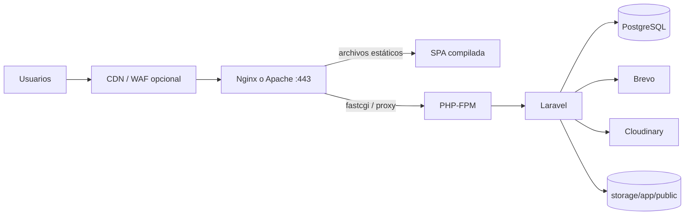

# 27. Despliegue en producción

No hay evidencia de un despliegue real en el repositorio (sin Docker, CI/CD ni configuración de servidor). Este capítulo describe una topología **recomendada** y un runbook reproducible. Está marcado como recomendación cuando no se pudo verificar contra el proyecto.

## 27.1 Topología recomendada



**Figura 1.** Topología de producción recomendada.

**Tabla.** _Componentes de la topología de producción_

| Componente | Recomendación |
|---|---|
| Servidor web | Nginx 1.24+ o Apache 2.4+ |
| PHP | PHP-FPM 8.2/8.3 |
| Base de datos | PostgreSQL 15/16 dedicado |
| TLS | Let's Encrypt o certificado corporativo |
| Caché/colas | Redis 7 (opcional pero recomendado) |
| Backups | Almacenamiento externo cifrado |
| Monitoreo | Logs + health check + alertas |

## 27.2 Preparar el servidor

```bash
sudo apt update
sudo apt install -y nginx php8.2-fpm php8.2-pgsql php8.2-mbstring \
  php8.2-xml php8.2-curl php8.2-bcmath php8.2-zip php8.2-intl \
  postgresql redis-server git unzip
```

Cree el usuario de servicio y el directorio:

```bash
sudo adduser --system --group --home /var/www/kaffa kaffa
sudo mkdir -p /var/www/kaffa
sudo chown -R kaffa:www-data /var/www/kaffa
```

## 27.3 Desplegar el backend

```bash
cd /var/www/kaffa
sudo -u kaffa git clone <repo> .
cd backend-kaffa
sudo -u kaffa composer install --no-dev --no-interaction --prefer-dist --optimize-autoloader
sudo -u kaffa cp .env.example .env
sudo -u kaffa php artisan key:generate
```

Edite `.env` con los valores de producción (capítulo 5). Luego:

```bash
sudo -u kaffa php artisan migrate --force
sudo -u kaffa php artisan storage:link
sudo -u kaffa php artisan config:cache
sudo -u kaffa php artisan route:cache
sudo -u kaffa php artisan view:cache
```

> **Advertencia.** `migrate --force` omite la confirmación. Ejecútelo solo tras un backup y una prueba en staging.

## 27.4 Nginx

```nginx
server {
    listen 80;
    server_name api.kaffa.example;
    return 301 https://$host$request_uri;
}

server {
    listen 443 ssl http2;
    server_name api.kaffa.example;

    root /var/www/kaffa/backend-kaffa/public;
    index index.php;

    ssl_certificate     /etc/letsencrypt/live/api.kaffa.example/fullchain.pem;
    ssl_certificate_key /etc/letsencrypt/live/api.kaffa.example/privkey.pem;

    client_max_body_size 12M;

    location / {
        try_files $uri $uri/ /index.php?$query_string;
    }

    location ~ \.php$ {
        include snippets/fastcgi-php.conf;
        fastcgi_pass unix:/run/php/php8.2-fpm.sock;
        fastcgi_param SCRIPT_FILENAME $realpath_root$fastcgi_script_name;
        fastcgi_param DOCUMENT_ROOT $realpath_root;
    }

    location ~ /\.(?!well-known).* {
        deny all;
    }

    location /storage/ {
        try_files $uri =404;
    }
}
```

Si la SPA se sirve desde el mismo dominio:

```nginx
location / {
    root /var/www/kaffa/frontend/dist;
    try_files $uri $uri/ /index.html;
}

location /api/ {
    proxy_pass http://127.0.0.1:8000;
    proxy_set_header Host $host;
    proxy_set_header X-Real-IP $remote_addr;
    proxy_set_header X-Forwarded-For $proxy_add_x_forwarded_for;
    proxy_set_header X-Forwarded-Proto $scheme;
}
```

## 27.5 Apache

```apache
<VirtualHost *:443>
    ServerName api.kaffa.example
    DocumentRoot /var/www/kaffa/backend-kaffa/public

    SSLEngine on
    SSLCertificateFile /etc/letsencrypt/live/api.kaffa.example/fullchain.pem
    SSLCertificateKeyFile /etc/letsencrypt/live/api.kaffa.example/privkey.pem

    <Directory /var/www/kaffa/backend-kaffa/public>
        AllowOverride All
        Require all granted
        Options FollowSymLinks
    </Directory>

    ErrorLog ${APACHE_LOG_DIR}/kaffa-error.log
    CustomLog ${APACHE_LOG_DIR}/kaffa-access.log combined
</VirtualHost>
```

Habilite `mod_rewrite`, `mod_ssl` y `mod_headers`.

## 27.6 PHP-FPM

`/etc/php/8.2/fpm/pool.d/kaffa.conf`:

```ini
[kaffa]
user = kaffa
group = www-data
listen = /run/php/php8.2-fpm.sock
listen.owner = www-data
listen.group = www-data
pm = dynamic
pm.max_children = 20
pm.start_servers = 4
pm.min_spare_servers = 2
pm.max_spare_servers = 8
pm.max_requests = 500
request_terminate_timeout = 60s
```

Ajuste `pm.max_children` según RAM y conexiones de PostgreSQL. Cada worker consume memoria; no lo dimensione “por si acaso”.

## 27.7 Compilar la SPA

```bash
cd /var/www/kaffa/REACT_clean/REACT_kaffa
pnpm install --frozen-lockfile
pnpm run build
sudo rsync -a --delete dist/ /var/www/kaffa/frontend/dist/
```

Configure `VITE_CLOUDINARY_*` en el entorno de build. La URL de API es relativa (`/api/v1`); si usa otro dominio, ajuste `api.js`.

## 27.8 Runbook de despliegue

```text
1. Anunciar ventana de mantenimiento (si hay migraciones).
2. Backup de base y storage.
3. git fetch && git checkout <tag>
4. composer install --no-dev
5. php artisan migrate --force
6. php artisan config:cache / route:cache / view:cache
7. pnpm build y publicar dist
8. Recargar PHP-FPM y Nginx
9. Smoke test: /health, login, catálogo, pedido de prueba
10. Monitorear logs y errores 5xx durante 15 min
```

## 27.9 Rollback

```bash
git checkout <tag-anterior>
composer install --no-dev
php artisan migrate:rollback --step=1   # solo si la migración es reversible
php artisan optimize:clear
sudo systemctl reload php8.2-fpm
```

Si la migración no es reversible, restaure el backup. Documente siempre el `down()`.

## 27.10 Variables de producción

Revise el checklist del capítulo 5. Como mínimo:

- `APP_ENV=production`
- `APP_DEBUG=false`
- `APP_URL` y `FRONTEND_URL` con HTTPS
- `DB_*` con usuario dedicado
- `SANCTUM_EXPIRATION=1440`
- `CORS_ALLOWED_ORIGINS` exacto
- SMTP Brevo
- `LOG_CHANNEL=daily`
- `SCRAMBLE_ENABLED=false`

## 27.11 Consideraciones de escalado

- La API es stateless (tokens), se puede balancear con varias instancias.
- PostgreSQL es el punto único; use réplicas de lectura solo si los reportes lo justifican.
- Redis para caché/colas si hay más de una instancia.
- El disco `storage/app/public` debe ser compartido o usar almacenamiento de objetos si hay varios nodos.
- Cloudinary evita compartir imágenes web entre nodos.

## 27.12 Checklist de despliegue

- [ ] Backup reciente verificado.
- [ ] `.env` de producción con secretos.
- [ ] `APP_DEBUG=false`.
- [ ] Migraciones probadas en staging.
- [ ] `storage:link` y permisos.
- [ ] HTTPS y redirección.
- [ ] CORS restringido.
- [ ] Colas/worker si aplica.
- [ ] Logs y alertas.
- [ ] Smoke test completo.
- [ ] Rollback documentado.
